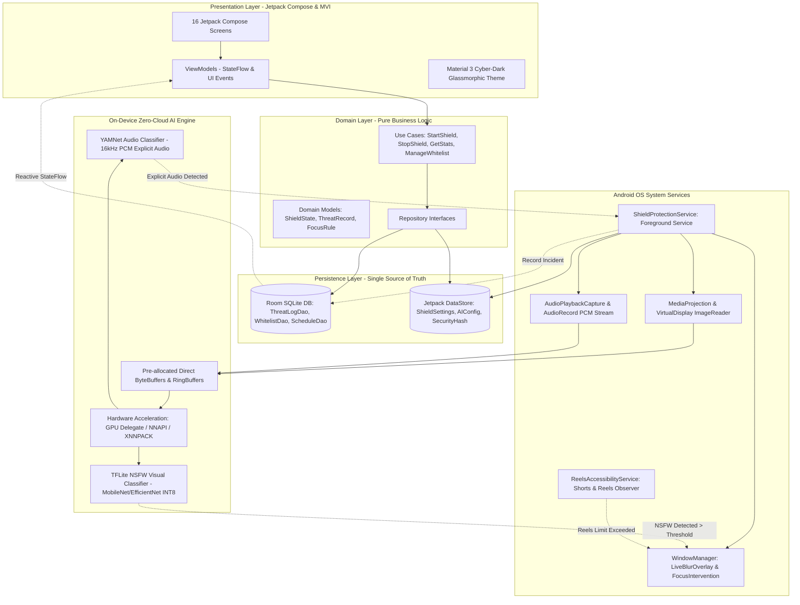
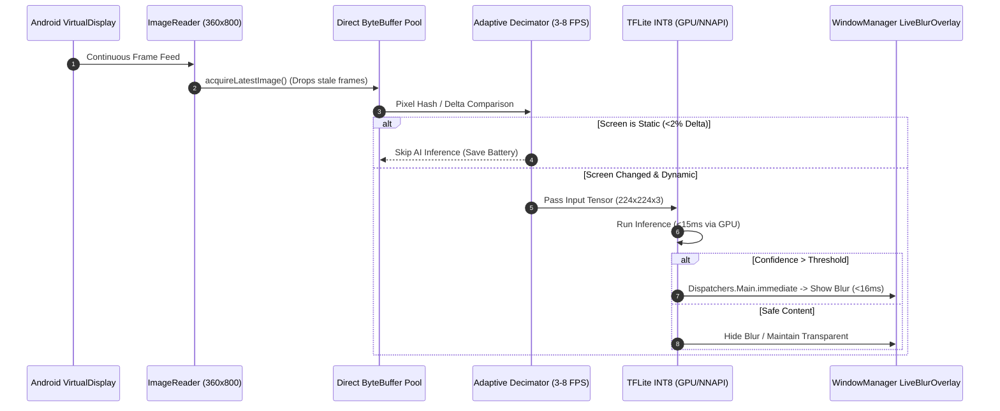
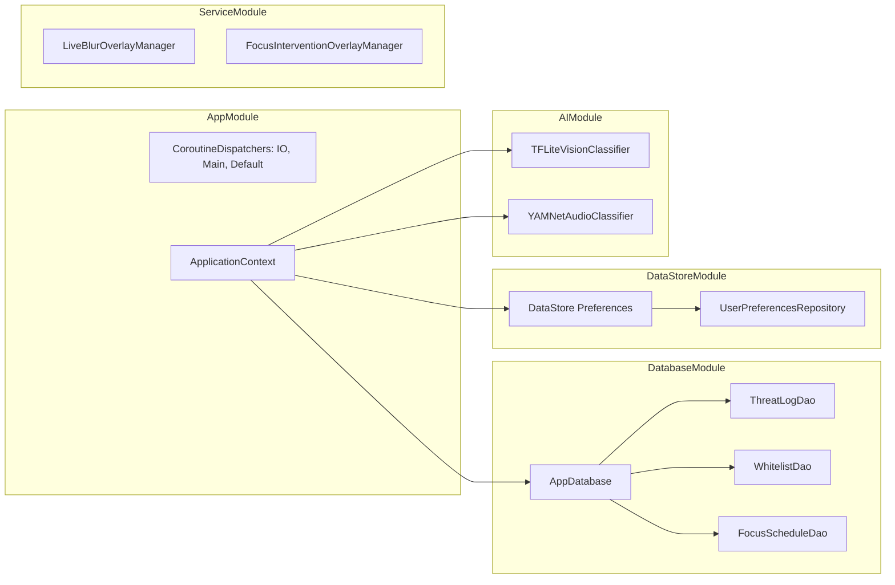

# SafeScreen — সিস্টেম আর্কিটেকচার ও এআই ইঞ্জিন ব্লুপ্রিন্ট (System Architecture & Zero-Lag AI Blueprint)

SafeScreen অ্যাপটি গুগলের প্রস্তাবিত আধুনিক অ্যান্ড্রয়েড স্থাপত্য নির্দেশনা, **Clean Architecture** নীতি এবং **100% On-Device, Zero-Cloud, Zero-Lag Privacy Guardian** দর্শনের ওপর ভিত্তি করে নকশা করা হয়েছে। 

এই ডকুমেন্টে অ্যাপের প্রতিটি আর্কিটেকচারাল লেয়ার, ডেটাস্টোর ও রুম ডাটাবেসের Single Source of Truth (SSOT) মেকানিজম, রিয়েল-টাইম স্ক্রিন ও অডিও প্রসেসিংয়ের জিরো-ল্যাগ কনকারেন্সি পাইপলাইন, হার্ডওয়্যার এক্সিলারেশন (GPU/NNAPI) এবং উইন্ডো ওভারলে ইন্টারভেনশন আর্কিটেকচার বিস্তারিতভাবে তুলে ধরা হলো।

---

## ১. উচ্চ-স্তরের আর্কিটেকচার চিত্র (High-Level System Architecture)

---

## ২. আর্কিটেকচারাল লেয়ারসমূহ (Detailed Layer Specifications)

### ক. Presentation Layer (`com.safescreen.app.presentation`)
- **পদ্ধতি:** MVI (Model-View-Intent) আর্কিটেকচার প্যাটার্ন এবং ইউনিডিরেকশনাল ডেটা ফ্লো (Unidirectional Data Flow - UDF)।
- **দায়িত্ব:** 
  - ব্যবহারকারীর জন্য সম্পূর্ণ ডিক্লোরেটিভ Jetpack Compose এবং Material 3 ভিত্তিক Cyber-Dark Glassmorphism UI প্রদর্শন করা।
  - ভিউমডেলের `uiState: StateFlow<UiState>` অবজার্ভ করে স্ক্রিন রেন্ডার করা।
  - ব্যবহারকারীর অ্যাকশনকে `onEvent(UiEvent)` আকারে ভিউমডেলে প্রেরণ করা।
- **স্ক্রিনসমূহ (16 Screens & Sheets):**
  1. `SplashScreen`: ব্র্যান্ড শিল্ড অ্যানিমেশন ও স্ট্যাটাস যাচাই।
  2. `OnboardingScreen`: ৩-স্লাইড পেজার, ফ্লুইড পিল ইন্ডিকেটর ও প্রাইভেসি প্রমিজ।
  3. `PermissionHubScreen`: ওএস পারমিশন হাব (৫টি ফ্রস্টেড পারমিশন কার্ড)।
  4. `BatteryOptimizationDialog`: গোল্ডেন অরবিটাল ডায়ালগ।
  5. `HomeScreen`: সেন্ট্রাল নিয়ন পালসিং শিল্ড বাটন, লাইভ মেট্রিক কার্ডস ও কুইক কন্ট্রোলস।
  6. `BlurStylePreviewSheet`: ফ্রস্টেড, পিক্সেল ও ব্ল্যাক স্প্লিট-ভিউ প্রিভিউ শিট।
  7. `ReelsControlScreen`: ৩ডি আওয়ারগ্লাস ও টাইম লিমিট স্লাইডার্স।
  8. `FocusScheduleScreen`: শিডিউল লিস্ট, ডে পিলস, টাইম পিকার ও অ্যাড শিট।
  9. `StatsScreen`: ডুয়াল-বার ট্রেন্ড চার্ট ও ডোনাট ক্যাটাগরি ব্রেকডাউন ক্যানভাস।
  10. `DetailedActivityLogScreen`: ক্যাটাগরি ফিল্টার চিপস, টাইমলাইন ফিড ও এম্পটি স্টেট।
  11. `SettingsScreen`: এআই সেনসিটিভিটি, এফপিএস পিলস, অটো-মিউট ও সিকিউরিটি টগলস।
  12. `AppWhitelistScreen`: সার্চ বার, ক্যাটাগরি ফিল্টার চিপস ও ব্যাংকিং প্রি-এক্সেম্পশন।
  13. `SecurityLockScreen`: ৩ডি সিকিউর প্যাডলক, ৪-ডট পিন প্যাড ও বায়োমেট্রিক অথেন্টিকেশন।
  14. `EmptyAndErrorStatesScreen`: ৪-ট্যাব সিস্টেম স্টেট সিমুলেটর (Clean, Paused, Error, Empty)।
  15. `LiveBlurOverlayView`: উইন্ডো ম্যানেজারে রেন্ডার হওয়া রিয়েল-টাইম ব্লার ভিউ।
  16. `FocusInterventionOverlay`: ফুলস্ক্রিন ফোকাস ইন্টারভেনশন ভিউ (5m Walk / 2m Pass)।

### খ. Domain Layer (`com.safescreen.app.domain`)
- **দায়িত্ব:** কোনো অ্যান্ড্রয়েড ফ্রেমওয়ার্ক বা লাইব্রেরির ওপর নির্ভর না করে ১০০% পিওর কোটলিন বিজনেস লজিক ধারণ করা।
- **মডেলস (`domain.model`):**
  - `ShieldConfig`: সেন্ট্রাল প্রোটেকশন কনফিগারেশন।
  - `ThreatRecord`: শনাক্ত হওয়া থ্রেটের মেটাডেটা।
  - `WhitelistApp`: অনুমোদিত অ্যাপের ডেটা।
  - `FocusSchedule`: ফোকাস সেশনের সময়সীমা ও দিনের তালিকা।
- **ইউজকেসসমূহ (`domain.usecase`):**
  - `ObserveShieldStateUseCase`: প্রোটেকশন সক্রিয় কি না তা লাইভ অবজার্ভ করা।
  - `ToggleShieldUseCase`: সেন্ট্রাল শিল্ড অন/অফ করা এবং সার্ভিস ট্রিগার করা।
  - `GetThreatStatsUseCase`: আজকের ও সাপ্তাহিক ব্লকিং অ্যানালিটিক্স সরবরাহ করা।
  - `ManageWhitelistUseCase`: ব্যাংকিং ও ব্যবহারকারীর নির্বাচিত অ্যাপ এক্সিম্পট করা।
  - `VerifySecurityPinUseCase`: SHA-256 ক্রিপ্টোগ্রাফিক হ্যাশ দিয়ে পিন ভেরিফাই করা।

### গ. Persistence Layer (Single Source of Truth - SSOT)
- **রুম ডাটাবেস (`data.local.room`):**
  - `AppDatabase.kt`: Room v1 ডাটাবেস। থ্রেড-সেফ সিঙ্গলটন ইনস্ট্যান্স।
  - `ThreatLogEntity` ও `ThreatLogDao`: প্রতিটি ব্লার/মিউট/ব্লক ইভেন্টের টাইমস্ট্যাম্প, ক্যাটাগরি, অ্যাপ প্যাকেজ নাম, সেভিয়ারিটি ও গৃহীত অ্যাকশন সংরক্ষণ করে। রিয়েক্টিভ `Flow<List<ThreatLogEntity>>` প্রদান করে।
  - `WhitelistEntity` ও `WhitelistDao`: অনুমোদিত অ্যাপ তালিকা। ডাটাবেস ক্রিয়েশন কলব্যাকে ৫টি ব্যাংকিং অ্যাপ (`PayPal`, `Bank of America`, `Google Pay`, `Chase`, `Revolut`) ডিফল্ট সিড হিসেবে প্রি-পপুলেটেড হয়।
  - `FocusScheduleEntity` ও `FocusScheduleDao`: ব্যবহারকারীর তৈরি ফোকাস শিডিউলসমূহ।
- **জেটপ্যাক ডেটাস্টোর (`data.local.datastore`):**
  - `UserPreferencesRepository.kt`: শিল্ড স্টেট (`isShieldActive`), ভিজ্যুয়াল ব্লার সুইচ (`isVisualActive`), অডিও মিউট সুইচ (`isAudioActive`), রিলস ব্লকার সুইচ (`isReelsActive`), এআই সেনসিটিভিটি লেভেল (`STRICT`, `BALANCED`, `RELAXED`), এফপিএস প্রোফাইল (`FPS_3`, `FPS_5`, `FPS_8`), ব্লার স্টাইল ও ইনটেনসিটি, এবং সিকিউরিটি পিন হ্যাশ সংরক্ষণ করে।
  - ব্যাকগ্রাউন্ড সার্ভিস ও ইউআই উভয়ই একই ডেটাস্টোর থেকে রিয়েক্টিভলি স্টেট পড়ে।

---

## ৩. এআই ও জিরো-ল্যাগ পারফরম্যান্স আর্কিটেকচার (Zero-Lag Performance Strategy)

রিয়েল-টাইম ফ্রেম রিডিং ও অডিও মনিটরিংয়ের সময় ফোনে যেন কোনো প্রকার ল্যাগ, ফ্রেম ড্রপ বা ডিভাইস অতিরিক্ত গরম না হয়, তার জন্য নিচের মাল্টি-টিয়ার আর্কিটেকচার চূড়ান্ত করা হয়েছে:

### ৩.১ ভিজ্যুয়াল প্রসেসিং পাইপলাইন (Screen Capture -> TFLite NSFW Filter)

#### জিরো-ল্যাগ স্ট্র্যাটেজির মূল স্তম্ভসমূহ:
1. **ডাউনস্কেলিং ও রেজোলিউশন অপ্টিমাইজেশন:**
   - স্ক্রিনের ফুল-রেজোলিউশন (১০৮০x২৪০০) সরাসরি নিউরাল নেটওয়ার্কে প্রসেস করা আত্মঘাতী।
   - `MediaProjection` দিয়ে `VirtualDisplay` তৈরি করার সময় ডাউনস্কেলড সাইজ (যেমন ৩৬০x৮০০ বা সরাসরি ২২৪x২২৪) নেওয়া হয়।
   - এর ফলে মেমোরি ব্যান্ডউইথ ৮৫% সাশ্রয় হয়।
2. **`acquireLatestImage()` বনাম `acquireNextImage()`:**
   - কোনো ফ্রেম কিউতে জমিয়ে রাখা হয় না। `ImageReader`-এ ফ্রেম প্রসেসিংয়ের সময় নতুন ফ্রেম এলে `acquireLatestImage()` কল করে শুধুমাত্র সর্বশেষ ফ্রেমটি রিড করা হয় এবং মাঝের সমস্ত পুরনো ফ্রেম তাৎক্ষণিক ড্রপ করা হয়। ফলে সিস্টেমে কোনো ফ্রেম-ল্যাগ বা বাফার ব্লট তৈরি হয় না।
3. **প্রি-অ্যালোকেটেড ডিরেক্ট বাইট-বাফার (Zero GC Pressure):**
   - প্রতি ফ্রেমে নতুন `Bitmap` তৈরি করলে অ্যান্ড্রয়েডের Garbage Collector (GC) বারবার ট্রিগার হয়ে অ্যাপ থমকে যাবে (Jank/Stutter)।
   - তাই দুটি প্রি-অ্যালোকেটেড `ByteBuffer.allocateDirect(224 * 224 * 3)` ও `Bitmap` পুলিং টেকনিক ব্যবহার করা হবে। ফলে শূন্য-মেমোরি অ্যালোকেশন নিশ্চিত হয়।
4. **অ্যাডাপ্টিভ ডেসিমেশন ও স্ট্যাটিক স্ক্রিন ডিটেকশন:**
   - স্ক্রিন যখন স্থির থাকে (যেমন ই-বুক বা নিউজ আর্টিকেল পড়ার সময়), পর পর দুটি ফ্রেমের পিক্সেল হ্যাশ চেক করে ৯০% ক্ষেত্রে এআই ইনফারেন্স সম্পূর্ণ স্কিপ করা হয়।
   - হাই-রিস্ক অ্যাপে (Instagram, TikTok, Twitter, Chrome) এফপিএস স্বয়ংক্রিয়ভাবে ৫–৮ এ বৃদ্ধি পায়, আর হোম স্ক্রিন বা নরমাল অ্যাপে ৩ এফপিএস-এ নেমে আসে।
5. **হার্ডওয়্যার এক্সিলারেশন (GPU / NNAPI / XNNPACK):**
   - TFLite Interpreter চালুর সময় অগ্রাধিকার ভিত্তিতে `GpuDelegate` অথবা `NnApiDelegate` ব্যবহার করা হয়।
   - GPU-তে ইনফারেন্স লেটেন্সি হয় মাত্র **৮ থেকে ১৫ মিলিসেকেন্ড**।
   - যদি লো-এন্ড ডিভাইসে জিপিইউ সাপোর্ট না থাকে, তবে ৪টি থ্রেড সহ `XNNPACK` CPU অপটিমাইজেশন কাজ করে (লেটেন্সি < ২৮ মিলিসেকেন্ড)।

---

### ৩.২ অডিও মনিটরিং পাইপলাইন (Audio Capture -> YAMNet Explicit Classifier)

1. **ইন্টারনাল মিডিয়া অডিও স্ট্রিম:**
   - Android 10+ এর `AudioPlaybackCaptureConfiguration` ব্যবহার করে ডিভাইসের ইন্টারনাল মিডিয়া স্ট্রিম ক্যাপচার করা হয় (মাইক্রোফোন ছাড়া)।
2. **অডিও ফ্রেম বাফারিং ও রিং-বাফার:**
   - 16,000 Hz স্যাম্পলিং রেট, 16-bit Mono PCM ফরম্যাটে অডিও রেকর্ড করা হয়।
   - একটি ডাবল-বাফারযুক্ত `RingBuffer<Short>` ব্যবহার করা হয় যা ব্যাকগ্রাউন্ড IO থ্রেডে অবিরাম পূর্ণ হয়।
3. **YAMNet ক্লাসিফিকেশন ও স্লাইডিং উইন্ডো:**
   - YAMNet মডেলটি ০.৯৭৫ সেকেন্ডের অডিও চাঙ্ক (~১৫,৬০০ স্যাম্পল) ইনপুট নেয়।
   - ৫০% ওভারল্যাপিং স্লাইডিং উইন্ডো ব্যবহার করে প্রতি ৫০০ মিলিসেকেন্ডে একবার ইনফারেন্স চালানো হয়।
4. **জিরো-ল্যাগ মিউট অ্যাকশন:**
   - অ্যাডাল্ট বা এক্সপ্লিসিট অডিও শনাক্ত হওয়া মাত্র `AudioManager.requestAudioFocus` অথবা অডিও মিউট কম্যান্ড ফায়ার করে **< ৩০ মিলিসেকেন্ডে** সাউন্ড বন্ধ করা হয়।
   - অডিও পাইপলাইন সম্পূর্ণ স্বাধীন কো-রুটিন স্কোপে (`Dispatchers.Default`) চলে, ফলে ভিজ্যুয়াল পাইপলাইনের সাথে এর কোনো সংঘর্ষ হয় না।

---

### ৩.৩ রিলস ও শর্ট ভিডিও ব্লকার (Accessibility Pipeline)

1. **ইভেন্ট ফিল্টারিং ও থ্রোটলিং:**
   - `AccessibilityEvent.TYPE_WINDOW_CONTENT_CHANGED` হাজার বার ফায়ার হতে পারে।
   - **ফিল্টার ১:** প্যাকেজ নেম চেক। যদি অ্যাক্টিভ অ্যাপ Instagram, YouTube, TikTok বা Facebook না হয়, তবে তাৎক্ষণিক ০% ওভারহেডে রিটার্ন।
   - **ফিল্টার ২:** ৩০০ মিলিসেকেন্ডের লজিক্যাল ডেবউন্স (Debounce)।
2. **উইন্ডো নোড ইন্সপেকশন:**
   - হার্ডকোডেড ভিউ আইডির ওপর নির্ভর না করে হায়ারার্কিকাল কন্টেন্ট ডিসক্রিপশন এবং নোড ট্যাগ ("Reels", "Shorts", "clips_viewer", "vertical_view_pager") স্ক্যান করা।
3. **ফোকাস ইন্টারভেনশন ট্রিগার:**
   - ইউজার নির্ধারিত সময়সীমা পার হলে সরাসরি `FocusInterventionOverlayManager` কল করে স্ক্রিনের ওপর ফুলস্ক্রিন ফোকাস ইন্টারভেনশন ডায়ালগ তুলে ধরা হয়।
   - ইউজার ৫-মিনিট মাইন্ডফুল ওয়াক নিলে টাইমার কাউন্টডাউন শুরু হয়, অন্যথায় `GLOBAL_ACTION_BACK` দিয়ে রিলস থেকে বের করে দেওয়া হয়।

---

## ৪. ব্যাকগ্রাউন্ড থ্রেডিং ও স্টেট ম্যানেজমেন্ট ম্যাট্রিক্স

| অপারেশন | থ্রেড / ডিসপ্যাচার | বাফারিং মেকানিজম | লেটেন্সি বাজেট |
| :--- | :--- | :--- | :--- |
| **Frame Capture** | `HandlerThread("CaptureThread")` | `ImageReader` Latest Drop Buffer | < 5 ms |
| **Frame Tensor Preprocess** | `Dispatchers.Default` | Pre-allocated Direct ByteBuffer | < 4 ms |
| **TFLite NSFW Inference** | Dedicated Inference Worker (GPU/NNAPI) | Single-Slot Mutex Free Execution | 8 - 15 ms |
| **Live Blur Overlay Trigger** | `Dispatchers.Main.immediate` | `WindowManager.addView / updateView` | < 16 ms |
| **Audio Capture** | `Dispatchers.IO` (Audio Thread) | 16kHz PCM `RingBuffer<Short>` | < 10 ms |
| **YAMNet Audio Inference** | `Dispatchers.Default` | 50% Sliding Window (0.975s Chunk) | 18 - 25 ms |
| **Audio Mute Action** | `Dispatchers.Main.immediate` | `AudioManager.adjustStreamVolume` | < 5 ms |
| **Reels A11y Inspection** | A11y Service Thread | 300ms Debounced Coroutine | < 8 ms |
| **Threat Log Database Write** | `Dispatchers.IO` | `Room SQLite Write Pool` | Async (Non-blocking) |
| **UI State Rendering** | `Dispatchers.Main` | Compose `StateFlow` Collection | 60 - 120 FPS |

---

## ৫. ডিপেন্ডেন্সি ইনজেকশন স্কিম (Dagger-Hilt DI Scheme)

---

## ৬. অ্যান্ড্রয়েড ওএস পারমিশন ও কমপ্লায়েন্স গাইডলাইন

1. **`SYSTEM_ALERT_WINDOW` (`Settings.canDrawOverlays`):**
   - স্ক্রিনের ওপর ব্লার এবং ইন্টারভেনশন ওভারলে ড্র করার জন্য আবশ্যক।
2. **`FOREGROUND_SERVICE_MEDIA_PROJECTION` (Android 14+):**
   - মিডিয়া প্রজেকশন সার্ভিস পরিচালনার জন্য মেনিফেস্টে স্পেসিফিক ফোরগ্রাউন্ড টাইপ ঘোষণা।
3. **`RECORD_AUDIO` & `AudioPlaybackCapture`:**
   - ইন্টারনাল মিডিয়া অডিও প্রসেসিংয়ের জন্য।
4. **`BIND_ACCESSIBILITY_SERVICE`:**
   - রিলস ও শর্টস স্ক্রোল শনাক্ত করার জন্য। ইউজারকে স্পষ্ট পারমিশন হাবের মাধ্যমে গাইড করা হবে।
5. **`REQUEST_IGNORE_BATTERY_OPTIMIZATIONS`:**
   - ওএস যাতে ব্যাকগ্রাউন্ড শিল্ড সার্ভিসকে কিল না করে।

---

*নথি সংস্করণ: ২.০ (মাস্টার আর্কিটেকচার ও জিরো-ল্যাগ এআই ব্লুপ্রিন্ট)*  
*প্রস্তুতকারক: Antigravity AI Pair Programmer*
