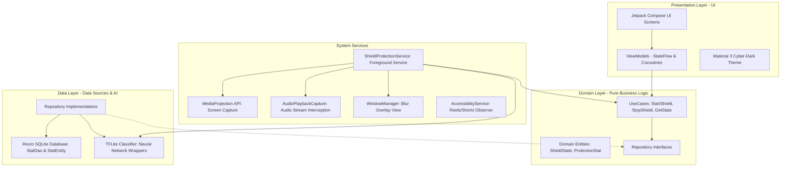

# SafeScreen — সিস্টেম আর্কিটেকচার (System Architecture)

SafeScreen অ্যাপটি গুগলের প্রস্তাবিত আধুনিক অ্যান্ড্রয়েড স্থাপত্য নির্দেশনা ও **Clean Architecture** নীতি অনুযায়ী নকশা করা হয়েছে। এটি কোডের নির্ভরতা (dependency) একমুখী রাখে এবং টেস্টিং ও রক্ষণাবেক্ষণ সহজ করে।

---

## ১. উচ্চ-স্তরের আর্কিটেকচার চিত্র (High-Level Architecture)

---

## ২. আর্কিটেকচারাল লেয়ারসমূহ (Detailed Layers)

### ক. Data Layer (`com.safescreen.app.data`)
- **দায়িত্ব:** যাবতীয় কাঁচা ডেটা সোর্স, লোকাল স্টোরেজ ও মেশিন লার্নিং মডেল পরিচালনা করা।
- **Local DB (`data.local`):**
  - Room Database (`AppDatabase`)
  - `StatEntity`: প্রতিটি ব্লার বা মিউট ইভেন্টের টাইমস্ট্যাম্প, ক্যাটাগরি, সংশ্লিষ্ট অ্যাপের প্যাকেজ নাম সংরক্ষণ করে।
  - `StatDao`: Reactive SQLite কোয়েরি (`Flow<List<StatEntity>>`) প্রদান করে।
- **Repository Implementation (`data.repository`):**
  - `StatRepositoryImpl`: ডোমেইন লেয়ারের ইন্টারফেস বাস্তবায়ন করে এবং ডাটাবেস সত্তা থেকে ডোমেইন মডেলে ম্যাপ করে।
- **TFLite Engine (`data.tflite`):**
  - `TFLiteClassifier`: ফ্রেম ইনপুট নিয়ে কোয়ান্টাইজড নিউরাল নেটওয়ার্কে প্রসেস করে এবং NSFW স্কোর/লেবেল রিটার্ন করে।

### খ. Domain Layer (`com.safescreen.app.domain`)
- **দায়িত্ব:** কোনো অ্যান্ড্রয়েড ফ্রেমওয়ার্কের ওপর নির্ভরশীল না থাকা বিশুদ্ধ বিজনেস লজিক।
- **Entities (`domain.model`):**
  - `ShieldState`: ইনঅ্যাক্টিভ, অ্যাক্টিভ, থ্রেট ডিটেকটেড ও পজড স্টেট।
  - `ProtectionStat`: ইউআই এবং বিজনেস লজিকে ব্যবহৃত ডেটা ক্লাস।
- **UseCases (`domain.usecase`):**
  - `StartShieldUseCase`: প্রোটেকশন সার্ভিস সক্রিয় করে।
  - `StopShieldUseCase`: প্রোটেকশন সার্ভিস নিষ্ক্রিয় করে।
  - `GetStatsUseCase`: অফলাইন হিস্ট্রি ও আজ কতগুলো ব্লক হয়েছে তার ফ্লো প্রদান করে।

### গ. Presentation Layer (`com.safescreen.app.presentation`)
- **দায়িত্ব:** সম্পূর্ণ ডিক্লোরেটিভ Jetpack Compose এবং Material 3 ব্যবহার করে ইউজার ইন্টারফেস প্রদর্শন করা।
- **স্ক্রিনসমূহ (`presentation.screens`):**
  1. `SplashScreen`: ব্র্যান্ড লোগো ও ইনিশিয়ালাইজেশন।
  2. `OnboardingScreen`: প্রাইভেসি ও ফিচারের পরিচিতি।
  3. `PermissionHubScreen`: ওএস পারমিশন রিকোয়েস্ট (Overlay, Screen Capture, Audio Capture, Notification)।
  4. `HomeScreen`: সেন্ট্রাল নিয়ন পালসিং শিল্ড বাটন ও লাইভ স্ট্যাটাস।
  5. `StatsScreen`: ফিল্টার হওয়া কন্টেন্টের বিস্তারিত অ্যানালিটিক্স।
  6. `SettingsScreen`: ফিল্টারিং সেনসিটিভিটি, অটো-মিউট ও রিলেস লিমিট সেটিংস।
- **থিম (`presentation.theme`):**
  - আধুনিক সাইবার-ডার্ক স্টাইল (Deep Black `#07090E`, Neon Cyan `#00E5FF`, Neon Green `#00FF9D`, Neon Pink `#FF2A6D`) এবং গ্লাস মরফিজম।

### ঘ. Background Services Layer (`com.safescreen.app.services`)
- `ShieldProtectionService`: একটি অ্যান্ড্রয়েড `ForegroundService` যার `foregroundServiceType="mediaProjection"` নির্ধারিত। এটি ডিসপ্লের ফ্রেম ক্যাপচার করে ব্যাকগ্রাউন্ড থ্রেডে `TFLiteClassifier`-এ পাঠায় এবং অডিও ইন্টারসেপ্ট করে।

---

## ৩. ডিপেন্ডেন্সি ইনজেকশন (Dependency Injection with Hilt)
- `@HiltAndroidApp` দ্বারা অ্যাপ্লিকেশন ইনিশিয়ালাইজড।
- `DatabaseModule`: Room ডেটাবেস এবং DAO-এর সিঙ্গলটন প্রভাইড করে।
- `AppModule`: থ্রেড ম্যানেজমেন্টের জন্য কো-রুটিন ডিসপ্যাচার (`@IoDispatcher`, `@MainDispatcher`) এবং TFLite ক্লাসিফায়ার প্রভাইড করে।
- ভিউমডেল ও সার্ভিসে নির্ভরতা ইনজেক্ট করার জন্য `@Inject` কনস্ট্রাক্টর ব্যবহার করা হয়েছে।

