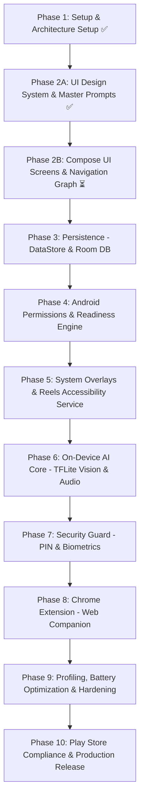

# SafeScreen — ডেভেলপমেন্ট রোডম্যাপ (Development Roadmap)

এই রোডম্যাপটি SafeScreen প্রজেক্টের পরিকল্পনা থেকে শুরু করে চূড়ান্ত প্রকাশ পর্যন্ত বাস্তবসম্মত ও পর্যায়ক্রমিক রূপরেখা প্রদান করে। এটি অ্যাপ্লিকেশনের Design-First স্ট্র্যাটেজি এবং আর্কিটেকচারাল নির্ভরতার সাথে সম্পূর্ণ সামঞ্জস্যপূর্ণ।

---

## 📌 রোডম্যাপ ফেজসমূহ

---

### ফেজ ১: প্রজেক্ট ইনিশিয়ালাইজেশন ও আর্কিটেকচার সেটআপ (সম্পন্ন ✅)
- [x] Android Kotlin KTS প্রজেক্ট সেটআপ (Min SDK 29, Target SDK 35, Java 21/17, Gradle 8.14)।
- [x] Jetpack Compose, Material 3, Navigation, Dagger-Hilt, Room, TFLite ডিপেন্ডেন্সি কনফিগারেশন।
- [x] Clean Architecture অনুযায়ী ৩-লেয়ার ফোল্ডার স্ট্রাকচার (data, domain, presentation, services, di)।
- [x] সাইবার-ডার্ক ও নিয়ন গ্লাস মরফিক থিম ইমপ্লিমেন্টেশন।
- [x] Gradle বিল্ড ও কম্পাইলেশন যাচাই (`./gradlew clean` ও বিল্ড সফল)।

---

### ফেজ ২A: UI/UX ডিজাইন-ফার্স্ট ওয়ার্কফ্লো ও সেন্ট্রাল ডিজাইন সিস্টেম (সম্পন্ন ✅)
- [x] `Screen Workflow/` ফোল্ডারের অধীনে ৮টি ক্যাটাগরিতে ১৬টি স্ক্রিনের সম্পূর্ণ ইউজার ফ্লো ম্যাপিং।
- [x] ChatGPT-এর সাহায্যে ১৬টি স্ক্রিনের ভিজ্যুয়াল রেফারেন্স ডিজাইন ইমেজ তৈরি ও সংরক্ষণ।
- [x] প্রতিটি স্ক্রিনের জন্য সেলফ-কন্টেইন্ড কোডিং প্রম্পট সহ `Screen Workflow/MASTER_UI_PROMPTS.md` পুনর্লিখন।
- [x] সেন্ট্রাল ডিজাইন স্পেসিফিকেশন [**`DESIGN.md`**](./DESIGN.md) তৈরি (কালার টোকেন, টাইপোগ্রাফি, গ্লাস মরফিজম, আইকন রুলস ও কোডিং এজেন্টের কাজের নিয়মাবলি)।
- [x] `PROJECT_PROGRESS.md` হালনাগাদ ও সমস্ত আর্কিটেকচারাল সিদ্ধান্তের নথিবদ্ধকরণ।

---

### ফেজ ২B: প্রেজেন্টেশন লেয়ার ও ১৬টি স্ক্রিনের কম্পোজ ইমপ্লিমেন্টেশন (বর্তমান টার্গেট ⏳)
- [ ] `presentation/navigation/Screen.kt`-এ ১৬টি স্ক্রিন ও বটম শিটের পূর্ণাঙ্গ রুট ম্যাপ ডিফাইন করা।
- [ ] কোর অ্যাটমিক কম্পোনেন্টস তৈরি: `TimeLimitSlider`, `SafeScreenStateView`, `NeonPillBadge` ইত্যাদি।
- [ ] মডিউল ০১: `SplashScreen` ও `OnboardingScreen` (৩-স্লাইড পেজার) তৈরি।
- [ ] মডিউল ০২: `PermissionHubScreen` ও `BatteryOptimizationDialog` বটম শিট তৈরি।
- [ ] মডিউল ০৩: `HomeScreen` (পালসিং সেন্ট্রাল শিল্ড, লাইভ মেট্রিক কার্ডস) ও `BlurStylePreviewSheet` তৈরি।
- [ ] মডিউল ০৪: `ReelsControlScreen` ও `FocusScheduleScreen` তৈরি।
- [ ] মডিউল ০৫: `StatsScreen` (Compose Canvas চার্ট) ও `DetailedActivityLogScreen` তৈরি।
- [ ] মডিউল ০৬: `SettingsScreen`, `AppWhitelistScreen` ও `SecurityLockScreen` তৈরি।
- [ ] মডিউল ০৭: `LiveBlurOverlayView` ও `FocusInterventionOverlay` কম্পোজেবল প্রস্তুতকরণ।
- [ ] মডিউল ০৮: `SafeScreenStates` (All Clean, Permission Paused, AI Core Error) কম্পোজেবলস তৈরি।
- [ ] প্রতিটি স্ক্রিনে **State Hoisting** (`UiState` ও `UiEvent`) এবং ডার্ক/লাইট মোডে `@Preview` নিশ্চিতকরণ।

---

### ফেজ ৩: লোকাল ডেটা ও কনফিগারেশন ম্যানেজমেন্ট (DataStore & Room DB)
- [ ] DataStore Preferences সেটআপ (শিল্ড স্টেট, ব্লার স্টাইল ও ইনটেনসিটি, রিলস লিমিট, পিন হ্যাশ)।
- [ ] Room SQLite ডাটাবেস এনটিটি ও ডিএও সম্প্রসারণ (`StatEntity`, `FocusScheduleEntity`, `WhitelistEntity`)।
- [ ] ডোমেইন UseCase-সমূহের সাথে রিপোজিটরি ডেটা সংযোগ (`GetStatsUseCase`, `SaveBlurConfigUseCase`)।
- [ ] ভিউমডেলের `StateFlow`-কে রুম ও ডাটাস্তোরের সাথে রিয়েক্টিভলি যুক্ত করা।

---

### ফেজ ৪: পারমিশন ইঞ্জিন ও ডিভাইস রেডি-নেস হাব (Real OS Permissions)
- [ ] `Settings.canDrawOverlays(context)` ও ওভারলে পারমিশন লঞ্চার হ্যান্ডলিং।
- [ ] Android 13+ `POST_NOTIFICATIONS` ও `RECORD_AUDIO` রানটাইম পারমিশন হ্যান্ডলিং।
- [ ] `PowerManager.isIgnoringBatteryOptimizations` ব্যাটারি এক্সেম্পশন রিকোয়েস্ট লঞ্চার।
- [ ] `AccessibilityManager` এনেবলড সার্ভিস ট্র্যাকিং।
- [ ] `MediaProjectionManager.createScreenCaptureIntent()` স্ক্রিন শেয়ারিং ইন্টেন্ট লঞ্চার।

---

### ফেজ ৫: সিস্টেম ওভারলে ও রিলস ইন্টারভেনশন সার্ভিস (Background & Overlays)
- [ ] `ShieldProtectionService` ফোরগ্রাউন্ড সার্ভিস ম্যানেজমেন্ট (`foregroundServiceType="mediaProjection"`)।
- [ ] `WindowManager` (`TYPE_APPLICATION_OVERLAY`) এ `ComposeView` দিয়ে লাইভ ব্লার উইন্ডো রেন্ডারিং।
- [ ] `SafeScreenAccessibilityService` রেজিস্টার করে ইনস্টাগ্রাম, ইউটিউব, টিকটক ও ফেসবুকের রিলস নোড ট্র্যাক করা।
- [ ] দৈনিক সময়সীমা শেষ হলে স্বয়ংক্রিয়ভাবে `FocusInterventionOverlay` ডিসপ্লে ও হোম স্ক্রিনে ফিরে আসার জেসচার।

---

### ফেজ ৬: অন-ডিভাইস এআই মেশিন লার্নিং কোর (TFLite Vision & Audio Guard)
- [ ] কোয়ান্টাইজড INT8 NSFW TFLite মডেল (MobileNetV3 / EfficientNet-Lite) `assets/models/` এ যুক্ত করা।
- [ ] `MediaProjection` -> `ImageReader` ফ্রেম ক্যাপচার লুপ (৩–৫ FPS) ও স্ট্যাটিক স্ক্রিন ডিটেকশন।
- [ ] `AudioPlaybackCaptureConfiguration` দিয়ে ইন্টারনাল অডিও স্ট্রিম নিয়ে YAMNet ক্লাসিফিকেশন ও অটো-মিউট।
- [ ] হোয়াইটলিস্ট করা অ্যাপের জন্য ফ্রেম প্রসেসিং ও অডিও ফিল্টারিং বাইপাস লজিক।

---

### ফেজ ৭: সিকিউরিটি গার্ড ও বায়োমেট্রিক অথেন্টিকেশন (Security Lock)
- [ ] `androidx.biometric.BiometricPrompt` এবং ক্রিপ্টোগ্রাফিক পিন হ্যাশ যাচাই।
- [ ] হোম স্ক্রিনের শিল্ড অফ করা বা সেটিংস খোলার সময় সিকিউরিটি গেট পপ-আপ।
- [ ] ভুল পিনের জন্য কুলডাউন টাইম-লক মেকানিজম।

---

### ফেজ ৮: Google Chrome Extension (Web Platform Companion)
- [ ] Manifest V3 স্ট্রাকচার, Service Worker ও Content Scripts তৈরি।
- [ ] ওয়েবে `DOM MutationObserver` দিয়ে ইমেজ ও ভিডিও ট্র্যাক করে ব্লার করা।
- [ ] CSS Injection দিয়ে ইউটিউব শর্টস ও ইনস্টাগ্রাম রিলস শেলফ পুরোপুরি লুকিয়ে ফেলা।

---

### ফেজ ৯: পারফরম্যান্স অপটিমাইজেশন, ব্যাটারি প্রোফাইলিং ও হার্ডেনিং
- [ ] Android Studio Profiler দিয়ে ব্যাটারি খরচ প্রতি ঘণ্টায় < ৩-৪% এবং র‍্যাম < ১৫০MB নিশ্চিত করা।
- [ ] মেমোরি লিক ও গার্বেজ কালেকশন (GC) প্রেসার অপটিমাইজেশন।
- [ ] ProGuard / R8 রুলস এবং প্রোডাকশন বিল্ড কনফিগারেশন।

---

### ফেজ ১০: গুগল প্লে কমপ্লায়েন্স ও প্রোডাকশন রিলিজ
- [ ] Prominent Disclosure ও প্রাইভেসি পলিসি ডায়ালগ কনফার্মেশন।
- [ ] গুগল প্লে কনসোলে Accessibility & Foreground Service ব্যবহারের সুনির্দিষ্ট ডিক্লারেশন।
- [ ] প্রোডাকশন রিলিজ বিল্ড (`release.aab`) সাইন ও প্রকাশ।
