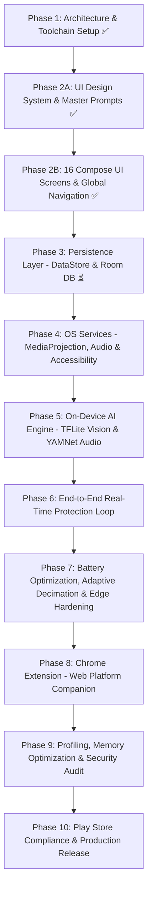

# SafeScreen — ডেভেলপমেন্ট রোডম্যাপ ও টেকনিক্যাল সিকোয়েন্স (Development Roadmap & Technical Sequence)

এই রোডম্যাপটি SafeScreen প্রজেক্টের পরিকল্পনা থেকে শুরু করে চূড়ান্ত প্রকাশ পর্যন্ত বাস্তবসম্মত, সুনির্দিষ্ট ও পর্যায়ক্রমিক রূপরেখা প্রদান করে। এটি অ্যাপ্লিকেশনের **Clean Architecture**, **Single Source of Truth (SSOT)** এবং **Zero-Lag On-Device AI Strategy**-র সাথে ১০০% সামঞ্জস্যপূর্ণ।

---

## 📌 রোডম্যাপ ফেজসমূহ (Master Phase Flowchart)

---

### ফেজ ১: প্রজেক্ট ইনিশিয়ালাইজেশন ও আর্কিটেকচার সেটআপ (সম্পন্ন ✅)
- [x] Android Kotlin KTS প্রজেক্ট সেটআপ (Min SDK 29, Target SDK 35, Java 21, Gradle 8.14, AGP 8.7.3)।
- [x] Jetpack Compose, Material 3, Navigation, Dagger-Hilt, Room, TFLite ডিপেন্ডেন্সি কনফিগারেশন।
- [x] Clean Architecture অনুযায়ী ৩-লেয়ার ফোল্ডার স্ট্রাকচার (data, domain, presentation, services, di)।
- [x] সাইবার-ডার্ক ও নিয়ন গ্লাস মরফিক থিম ইমপ্লিমেন্টেশন।
- [x] Gradle বিল্ড ও কম্পাইলেশন যাচাই (`./gradlew clean assembleDebug` সফল)।

---

### ফেজ ২A: UI/UX ডিজাইন-ফার্স্ট ওয়ার্কফ্লো ও সেন্ট্রাল ডিজাইন সিস্টেম (সম্পন্ন ✅)
- [x] `Screen Workflow/` ফোল্ডারের অধীনে ৮টি ক্যাটাগরিতে ১৬টি স্ক্রিনের সম্পূর্ণ ইউজার ফ্লো ম্যাপিং।
- [x] ১৬টি স্ক্রিনের হাই-রেজোলিউশন ভিজ্যুয়াল রেফারেন্স ডিজাইন ইমেজ ও প্রম্পট বুক সংরক্ষণ।
- [x] প্রতিটি স্ক্রিনের জন্য সেলফ-কন্টেইন্ড কোডিং প্রম্পট সহ `Screen Workflow/MASTER_UI_PROMPTS.md` পুনর্লিখন।
- [x] সেন্ট্রাল ডিজাইন স্পেসিফিকেশন [**`DESIGN.md`**](./DESIGN.md) তৈরি (কালার টোকেন, টাইপোগ্রাফি, গ্লাস মরফিজম, আইকন রুলস)।
- [x] `PROJECT_PROGRESS.md` হালনাগাদ ও সমস্ত আর্কিটেকচারাল সিদ্ধান্তের নথিবদ্ধকরণ।

---

### ফেজ ২B: প্রেজেন্টেশন লেয়ার ও ১৬টি স্ক্রিনের কম্পোজ ইমপ্লিমেন্টেশন (সম্পন্ন ও অডিটকৃত ✅)
- [x] `presentation/navigation/Screen.kt`-এ ১৬টি স্ক্রিন ও বটম শিটের পূর্ণাঙ্গ রুট ম্যাপ ডিফাইন করা।
- [x] গ্লোবাল ৪-ট্যাব ফ্লোটিং বটম বার (`FloatingBottomNavigationBar.kt`) ও অটো-হাইড লজিক।
- [x] কোর রি-ইউজেবল কম্পোনেন্টস: `TimeLimitSlider`, `SafeScreenStateView`, `GlassmorphicCard`, `ShieldButton`, `NeonSwitch`।
- [x] মডিউল ০১: `SplashScreen` ও `OnboardingScreen` (৩-স্লাইড পেজার, ফ্লুইড পিল অ্যানিমেশন)।
- [x] মডিউল ০২: `PermissionHubScreen` (৫টি কার্ড) ও `BatteryOptimizationDialog` বটম শিট।
- [x] মডিউল ০৩: `HomeScreen` (পালসিং সেন্ট্রাল শিল্ড, লাইভ মেট্রিক কার্ডস) ও `BlurStylePreviewSheet` (৩-স্টাইল স্প্লিট ভিউ)।
- [x] মডিউল ০৪: `ReelsControlScreen` (৩ডি আওয়ারগ্লাস) ও `FocusScheduleScreen` (শিডিউল ও ডে পিলস)।
- [x] মডিউল ০৫: `StatsScreen` (ডুয়াল-বার চার্ট ও ডোনাট ব্রেকডাউন) ও `DetailedActivityLogScreen` (টাইমলাইন ও ফিল্টার)।
- [x] মডিউল ০৬: `SettingsScreen` (এআই টিউন), `AppWhitelistScreen` (সার্চ ও ব্যাংকিং প্রি-এক্সেম্পশন) ও `SecurityLockScreen` (পিন ও বায়োমেট্রিক)।
- [x] মডিউল ০৭: `LiveBlurOverlayView` ও `FocusInterventionOverlay` কম্পোজেবলস উইথ WindowManager লাইফসাইকেল।
- [x] মডিউল ০৮: `SafeScreenStateView` (Clean, Paused, AI Error, Empty Log) ও `EmptyAndErrorStatesScreen`।
- [x] ডিপ স্ক্যান পলিশ: গ্লোবাল সিল্কি মোশন ট্রানজিশন, কীবোর্ড IME প্যাডিং, ডায়ালগ স্ক্রোল সেফটি ও কিপ্যাড হ্যাপটিক্স।
- [x] এমুলেটরে (Pixel 9, Android 15) ১০০% লাইভ টেস্ট ও কম্পাইলেশন যাচাই (০ এরর, ০ ওয়ার্নিং)।

---

### ফেজ ৩: লোকাল পারসিস্টেন্স লেয়ার (Room Database & DataStore Preferences - বর্তমান টার্গেট ⏳)
*লক্ষ্য: সমস্ত স্ট্যাটিক মক স্টেট থেকে বেরিয়ে অ্যাপের ডেটাকে একক সত্যের উৎসে (SSOT) রূপান্তর করা।*
- [ ] **Prompt 1: Room DB Infrastructure (`AppDatabase.kt`, Entities & DAOs):**
  - `ThreatLogEntity.kt` ও `ThreatLogDao.kt` (টাইমস্ট্যাম্প, ক্যাটাগরি, প্যাকেজ নেম, সেভিয়ারিটি, অ্যাকশন, রিয়েক্টিভ ফ্লো কোয়েরিজ)।
  - `WhitelistEntity.kt` ও `WhitelistDao.kt` (প্যাকেজ নেম, অ্যাপ নেম, ক্যাটাগরি, এক্সিম্পটেড স্টেট, ব্যাংকিং ডিফল্ট ফ্ল্যাগ)।
  - `FocusScheduleEntity.kt` ও `FocusScheduleDao.kt` (শিডিউল নেম, স্টার্ট/এন্ড টাইম, অ্যাক্টিভ ডেইজ, এনাবেলড)।
  - Room ডাটাবেস ক্রিয়েশন কলব্যাক দিয়ে ৫টি ব্যাংকিং অ্যাপ (`PayPal`, `Bank of America`, `Google Pay`, `Chase`, `Revolut`) ডিফল্ট সিড হিসেবে প্রি-পপুলেশন।
  - `DatabaseModule.kt`: Hilt দ্বারা থ্রেড-সেফ ডিবি ও ডিএও প্রভিশন।
- [ ] **Prompt 2: Jetpack DataStore Preferences Repository:**
  - `UserPreferencesRepository.kt` তৈরি।
  - শিল্ড টগলস (`isProtectionEnabled`, `isVisualActive`, `isAudioActive`, `isReelsActive`)।
  - এআই কনফিগারেশন (`aiSensitivity`, `fpsProfile`, `blurStyle`, `blurIntensity`)।
  - সিকিউরিটি স্টেট (`isPinLockEnabled`, `pinHashSha256`, `isBiometricEnabled`)।
  - Hilt `DataStoreModule.kt` কনফিগারেশন।
- [ ] **Prompt 3: Presentation ViewModels Integration:**
  - `HomeViewModel`, `StatsViewModel`, `SettingsViewModel`, `AppWhitelistViewModel`, `DetailedActivityLogViewModel`, `FocusScheduleViewModel` কে মক ডেটা থেকে মুক্ত করে রিয়েল রুম ও ডেটাস্টোর ফ্লো-এর সাথে বাইন্ড করা।

---

### ফেজ ৪: অ্যান্ড্রয়েড ওএস পারমিশন ও ব্যাকগ্রাউন্ড সিস্টেম সার্ভিসেস
*লক্ষ্য: ওএস হার্ডওয়্যার এবং ব্যাকগ্রাউন্ড সার্ভিসের সাথে অ্যাপকে সরাসরি সংযুক্ত করা।*
- [ ] **Prompt 1: Foreground Service & Sticky Notification:**
  - `ShieldProtectionService.kt` (`foregroundServiceType="mediaProjection"` সহ স্টিকি লাইভ নোটিফিকেশন, কুইক অ্যাকশনস: Pause 5m, Resume, Stop)।
- [ ] **Prompt 2: MediaProjection & VirtualDisplay ImageReader Buffer:**
  - ইউজার স্ক্রিন শেয়ারিং পারমিশন রেজাল্ট টোকেন ক্যাপচার।
  - `ImageReader` (360x800 RGBA_8888) তৈরি এবং `acquireLatestImage()` ফ্রেম ড্রপ মেকানিজম সহ `HandlerThread` সেটআপ।
- [ ] **Prompt 3: AudioPlaybackCapture & PCM Stream:**
  - Android 10+ `AudioPlaybackCaptureConfiguration` ও 16kHz Mono PCM `RingBuffer<Short>` অডিও পাইপলাইন।
- [ ] **Prompt 4: Accessibility Service for Reels:**
  - `ReelsAccessibilityService.kt` (Instagram, YouTube, TikTok, Facebook-এর উইন্ডো ও স্ক্রোল নোড ৩০০ms ডেবউন্স সহ স্ক্যান করা)।
- [ ] **Prompt 5: System WindowManager Overlay Wiring:**
  - `LiveBlurOverlayManager` ও `FocusInterventionOverlayManager` কে ব্যাকগ্রাউন্ড সার্ভিসের সাথে বাইন্ড করা।

---

### ফেজ ৫: অন-ডিভাইস এআই কোর ইঞ্জিন (TFLite Vision & YAMNet Audio)
*লক্ষ্য: জিরো-ক্লাউড, জিরো-ল্যাগ এবং হার্ডওয়্যার এক্সিলারেটেড নিউরাল নেটওয়ার্ক ইনফারেন্স।*
- [ ] **Prompt 1: TFLite Visual NSFW Classifier Integration:**
  - কোয়ান্টাইজড INT8 MobileNetV3 / EfficientNet-Lite মডেল `assets/models/nsfw_mobilenet_v3_int8.tflite` যুক্ত করা।
  - GPU Delegate (`GpuDelegate`) এবং NNAPI Delegate ফলব্যাক কনফিগারেশন।
  - প্রি-অ্যালোকেটেড ডিরেক্ট `ByteBuffer` (224x224x3) টেন্সর ইনপুট।
- [ ] **Prompt 2: YAMNet Audio Classifier Integration:**
  - YAMNet কোয়ান্টাইজড মডেল `assets/models/yamnet_audio_int8.tflite` যুক্ত করা।
  - 16kHz PCM থেকে মেল-স্পেকট্রোগ্রাম এক্সট্র্যাকশন ও ০.৯৭৫ সেকেন্ডের চাঙ্ক ক্লাসিফিকেশন।
- [ ] **Prompt 3: Adaptive Decimation & Static Screen Delta Detector:**
  - স্ক্রিন স্থির থাকলে (<২% ডেল্টা) এআই স্কিপ করা, হাই-রিস্ক অ্যাপে ৫-৮ FPS অ্যাডাপ্টিভ স্কেলিং।

---

### ফেজ ৬: এন্ড-টু-এন্ড রিয়েল-টাইম প্রোটেকশন লুপ (The Heartbeat)
*লক্ষ্য: সমস্ত লেয়ারকে একটি নিরবচ্ছিন্ন, সুরক্ষিত ও অতি-দ্রুত রিয়েক্টিভ লুপে সিঙ্ক করা।*
- [ ] স্ক্রিন ফ্রেমে NSFW শনাক্ত হলে (<৫০ms-এ) `LiveBlurOverlayView` দৃশ্যমান হওয়া এবং কন্টেন্ট সেফ হলে হাইড হওয়া।
- [ ] এক্সপ্লিসিট অডিও শনাক্ত হলে (<৩০ms-এ) ওএস অডিও স্ট্রিম মিউট হওয়া।
- [ ] রিলস লিমিট অতিক্রম করলে `FocusInterventionOverlay` ফুলস্ক্রিনে ভেসে ওঠা।
- [ ] প্রতিটি ঘটনা স্বয়ংক্রিয়ভাবে `ThreatLogDao`-তে এসিনক্রোনাসলি ইনসার্ট হওয়া এবং ইউআই ড্যাশবোর্ডে লাইভ চার্ট আপডেট হওয়া।
- [ ] হোয়াইটলিস্টেড অ্যাপের ক্ষেত্রে এআই প্রসেসিং ০% ওভারহেডে বাইপাস হওয়া।

---

### ফেজ ৭: ব্যাটারি অপটিমাইজেশন, অ্যাডাপ্টিভ স্লিপ ও এজ-কেস হার্ডেনিং
- [ ] স্ক্রিন অফ হলে (`ACTION_SCREEN_OFF`) এআই ও ক্যাপচার সম্পূর্ণ স্লিপে যাওয়া (দৈনিক ব্যাটারি ড্রেন < ৩-৫%)।
- [ ] মেমোরি লিক অডিট (WeakReference ও বিটম্যাপ রিসাইক্লিং)।
- [ ] লো-র‍্যাম ডিভাইস প্রোফাইলিং।

---

### ফেজ ৮: Google Chrome Extension (Web Platform Companion)
- [ ] Manifest V3 স্ট্রাকচার, Service Worker ও Content Scripts তৈরি।
- [ ] ওয়েবে `DOM MutationObserver` দিয়ে ইমেজ ও ভিডিও ট্র্যাক করে ব্লার করা।
- [ ] CSS Injection দিয়ে ইউটিউব শর্টস ও ইনস্টাগ্রাম রিলস শেলফ পুরোপুরি লুকিয়ে ফেলা।

---

### ফেজ ৯: পারফরম্যান্স অপটিমাইজেশন, সিকিউরিটি অডিট ও অবফাসকেশন
- [ ] Android Studio Profiler দিয়ে র‍্যাম < ১৫০MB নিশ্চিত করা।
- [ ] ProGuard / R8 রুলস (TFLite, Room ও Coroutines অপটিমাইজেশন)।
- [ ] ট্যাম্পার প্রুফিং ও সিকিউরিটি টেস্ট।

---

### ফেজ ১০: গুগল প্লে কমপ্লায়েন্স ও প্রোডাকশন রিলিজ
- [ ] Prominent Disclosure ও প্রাইভেসি পলিসি ডায়ালগ কনফার্মেশন।
- [ ] গুগল প্লে কনসোলে Accessibility & Foreground Service ব্যবহারের সুনির্দিষ্ট ডিক্লারেশন।
- [ ] প্রোডাকশন রিলিজ বিল্ড (`release.aab`) সাইন ও প্রকাশ।
