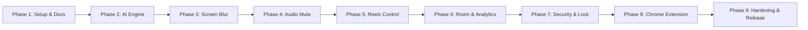

# SafeScreen — ডেভেলপমেন্ট রোডম্যাপ (Development Roadmap)

এই রোডম্যাপটি SafeScreen প্রজেক্টের পরিকল্পনা থেকে শুরু করে চূড়ান্ত প্রকাশ পর্যন্ত পর্যায়ক্রমিক রূপরেখা প্রদান করে।

---

## 📌 রোডম্যাপ ফেজসমূহ

---

### ফেজ ১: প্রজেক্ট ইনিশিয়ালাইজেশন ও আর্কিটেকচার সেটআপ (সম্পন্ন ✅)
- [x] Android Kotlin KTS প্রজেক্ট সেটআপ (Min SDK 29, Target SDK 35)।
- [x] Jetpack Compose, Material 3, Navigation, Dagger-Hilt, Room, TFLite ডিপেন্ডেন্সি কনফিগারেশন।
- [x] Clean Architecture অনুযায়ী ৩-লেয়ার ফোল্ডার স্ট্রাকচার (data, domain, presentation, services, di)।
- [x] নেভিগেশন হোস্ট সহ ৬টি স্ক্রিনের ডামি ও কম্পোনেন্ট আর্কিটেকচার।
- [x] সাইবার-ডার্ক ও নিয়ন গ্লাস মরফিক থিম ইমপ্লিমেন্টেশন।
- [x] সার্বিক প্রজেক্ট ডকুমেন্টেশন সিস্টেম প্রস্তুতকরণ।
- [x] Gradle বিল্ড ও কম্পাইলেশন যাচাই (`./gradlew assembleDebug` সফল)।

---

### ফেজ ২: অন-ডিভাইস মেশিন লার্নিং ইঞ্জিন (On-Device AI Engine)
- [ ] হালকা ওয়ান-ডিভাইস NSFW ইমেজ ক্লাসিফিকেশন TFLite মডেল (MobileNetV3 বা EfficientNet-Lite ভিত্তিক কোয়ান্টাইজড INT8) নির্বাচন ও ইন্টিগ্রেশন।
- [ ] ইয়ামনেট (YAMNet) বা কাস্টম অডিও ক্লাসিফিকেশন TFLite মডেল ইন্টিগ্রেশন (মিউজিক বনাম কথা শনাক্ত করার জন্য)।
- [ ] CPU বনাম NNAPI / GPU ডেলিগেটের পারফরম্যান্স ও লেটেন্সি বেঞ্চমার্কিং।
- [ ] মেমরি লিক রোধ ও গার্বেজ কালেকশন (GC) প্রেসার কমানোর জন্য অপ্টিমাইজড বাফার ম্যানেজমেন্ট।

---

### ফেজ ৩: স্ক্রিন ক্যাপচার ও রিয়েল-টাইম ব্লার ওভারলে (Screen Capture & Blur)
- [ ] `MediaProjectionManager` দিয়ে ইউজার সম্মতি নিয়ে ভার্চুয়াল ডিসপ্লে (`ImageReader`) তৈরি।
- [ ] ফ্রেমরেট অপটিমাইজেশন: প্রতি সেকেন্ডে সর্বোচ্চ ৩-৫টি ফ্রেম স্যাম্পলিং এবং স্ট্যাটিক স্ক্রিন ডিটেকশন।
- [ ] `WindowManager`-এর মাধ্যমে `TYPE_APPLICATION_OVERLAY` উইন্ডোতে ব্লার ইফেক্ট ভিউ রেন্ডারিং।
- [ ] রিয়েল-টাইমে NSFW কনটেন্ট শনাক্ত হলে তাৎক্ষণিক ব্লার ও কনটেন্ট চলে গেলে আনব্লার লজিক।
- [ ] `FLAG_SECURE` সংক্রান্ত এক্সেপশন হ্যান্ডলিং।

---

### ফেজ ৪: অডিও ক্যাপচার ও অটো-মিউট প্রোটেকশন (Audio Capture & Auto-Mute)
- [ ] Android 10+ এর `AudioPlaybackCaptureConfiguration` ব্যবহার করে `AudioRecord` স্ট্রিম ওপেন।
- [ ] মাইক্রোফোন ইনপুটের বদলে ডিভাইসের ইন্টারনাল মিডিয়া অডিও ট্র্যাক ক্যাপচার।
- [ ] অডিও স্পেকট্রোগ্রাম ফ্রেম TFLite মডেলে পাঠিয়ে মিউজিক প্যাটার্ন যাচাই।
- [ ] মিউজিক শনাক্ত হলে `AudioManager.requestAudioFocus` অথবা স্ট্রিম ভলিউম সাপ্রেস করে মিউট করা।

---

### ফেজ ৫: Reels, Shorts ও TikTok কন্ট্রোল (Short-Form Video Interventions)
- [ ] `AccessibilityService` কনফিগার করে Facebook, Instagram, YouTube এবং TikTok-এর নোড হায়ারার্কি ট্র্যাক করা।
- [ ] শর্টস/রিলস স্ক্রিনে প্রবেশ করার ইভেন্ট ও স্ক্রল কাউন্ট হিসাব করা।
- [ ] দৈনিক সময়সীমা শেষ হলে ওভারলে অ্যালার্ট বা স্বয়ংক্রিয়ভাবে হোম স্ক্রিনে ফিরে আসার জেসচার অ্যাকশন।
- [ ] অ্যাপ আপডেটজনিত নোড আইডি পরিবর্তন প্রতিরোধে রেজিলিয়েন্ট ফলব্যাক মেকানিজম।

---

### ফেজ ৬: অ্যানালিটিক্স, অফলাইন স্ট্যাটিস্টিকস ও ডেটাবেস
- [ ] Room SQLite-এ ব্লার কাউন্ট, মিউট কাউন্ট ও স্ক্রলিং টাইম সেভ করার UseCase তৈরি।
- [ ] `StatsScreen`-এ লাইভ চার্ট ও উইকলি সামারি গ্রাফ (Compose Canvas দিয়ে) রেন্ডার করা।
- [ ] সম্পূর্ণ ডেটা লোকাল ডিভাইসে এনক্রিপ্ট করার অপশন।

---

### ফেজ ৭: অ্যাপ হোয়াইটলিস্ট ও সিকিউরিটি লক (Security & Whitelist)
- [ ] ইনস্টল করা অ্যাপের লিস্ট আনা এবং ব্যবহারকারীকে সুরক্ষামুক্ত অ্যাপ বেছে নেওয়ার ইন্টারফেস প্রদান।
- [ ] `BiometricPrompt` এবং পাসকোড লক ইন্টিগ্রেশন, যাতে অনাকাঙ্ক্ষিতভাবে কেউ সেটিংস পরিবর্তন করতে না পারে।

---

### ফেজ ৮: Google Chrome Extension (Web Platform)
- [ ] Manifest V3 স্ট্রাকচার তৈরি।
- [ ] ওয়েব পেজে `MutationObserver` দিয়ে ইমেজ ও ভিডিও এলিমেন্ট ডিটেক্ট করা।
- [ ] WebAssembly / TFLite Web অথবা লাইটওয়েট রুলস দিয়ে ব্রাউজারে ব্লার ও অডিও কন্ট্রোল।

---

### ফেজ ৯: পারফরম্যান্স অপটিমাইজেশন, টেস্টিং ও প্রোডাকশন
- [ ] Android Studio Profiler দিয়ে ব্যাটারি কনজাম্পশন ড্রেন প্রোফাইলিং।
- [ ] রিগ্রেশন ও স্ট্রেস টেস্ট সম্পন্ন করা।
- [ ] প্রোডাকশন ProGuard/R8 রুলস এবং রিলিজ বিল্ড প্রস্তুতি।

