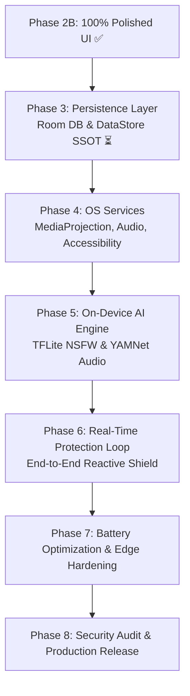

# SafeScreen — প্রজেক্ট প্রগ্রেস ও সম্পূর্ণ হ্যান্ডওভার রিপোর্ট (Project Progress & Master Handover Report)

> ## ⚠️ MANDATORY INSTRUCTION FOR ALL FUTURE CODING AGENTS & DEVELOPERS ⚠️
> **অত্যন্ত গুরুত্বপূর্ণ বাধ্যতামূলক নির্দেশনা (যেকোনো ডিভাইসে কাজ শুরুর পূর্বে অবশ্যই পড়ুন):**  
> আপনি যদি বাসা, অফিস বা অন্য যেকোনো ডিভাইসে অন্য কোনো এআই এজেন্ট (Antigravity, Cursor, Claude Dev, Copilot, ইত্যাদি) বা মানব ডেভেলপার হিসেবে কাজ শুরু করেন, তবে কোডিং শুরুর পূর্বে নিচের নির্দেশনাগুলো অক্ষরে অক্ষরে অনুসরণ করুন:
>
> 1. **বাধ্যতামূলক কনটেক্সট লোডিং (Mandatory Reading Order):**
>    - [**`PROJECT_PROGRESS.md`**](./PROJECT_PROGRESS.md) (এই ফাইল — বর্তমান অবস্থা, সমস্ত সমস্যার সমাধান ও পরবর্তী হ্যান্ডওভার রোডম্যাপ)
>    - [**`DESIGN.md`**](./DESIGN.md) (সাইবার-ডার্ক গ্লাস মরফিজম ডিজাইন সিস্টেম, নিয়ন কালার প্যালেট, প্যাডিং ও কম্পোনেন্ট স্ট্যান্ডার্ড)
>    - [**`Screen Workflow/MASTER_UI_PROMPTS.md`**](./Screen%20Workflow/MASTER_UI_PROMPTS.md) (১৬টি স্ক্রিনের সুনির্দিষ্ট প্রম্পট বুক ও আর্কিটেকচারাল রিকোয়ারমেন্টস)
>    - [**`PROJECT_CONTEXT_BN.md`**](./PROJECT_CONTEXT_BN.md) (সেফস্ক্রিন প্রজেক্টের ফিলোসফি, ১০০% অন-ডিভাইস এআই গার্ডিয়ান ও প্রাইভেসি স্ট্যান্ডার্ড)
>    - [**`DEVELOPMENT_ROADMAP.md`**](./DEVELOPMENT_ROADMAP.md) (১০টি সুস্পষ্ট ফেজের সম্পূর্ণ রোডম্যাপ)
>    - [**`ARCHITECTURE.md`**](./ARCHITECTURE.md) (Clean Architecture: Data, Domain, Presentation, Services, DI)
>
> 2. **ধাপে ধাপে বাস্তবায়ন ও স্পষ্ট অনুমতি নীতি (Strict Step-by-Step Policy):**  
>    কোনো অবস্থাতেই একসাথে একাধিক স্ক্রিন বা একাধিক মডিউলের কোড লিখবেন না। প্রতিটি Prompt সম্পূর্ণ শেষ করে, `./gradlew assembleDebug` দিয়ে বিল্ড ও এমুলেটরে লাইভ টেস্ট করে, ব্যবহারকারীকে সাইড-বাই-সাইড রিপোর্ট দেখিয়ে তাঁর কাছ থেকে স্পষ্ট **"Go ahead"** (অনুমতি) পাওয়ার পরেই কেবল পরবর্তী Prompt শুরু করবেন। ইউজার অনুমতি না দেওয়া পর্যন্ত পরবর্তী কোনো ধাপে হাত দেবেন না।
>
> 3. **সেশন শেষে বাধ্যতামূলক হ্যান্ডওভার আপডেট:**  
>    প্রতিটি কাজের সেশন শেষ করার পর অবশ্যই এই `PROJECT_PROGRESS.md` আপডেট করতে হবে এবং গিটহাবে পুশ করতে হবে।

---

## 📌 ১. প্রজেক্টের বর্তমান ওভারভিউ ও লাইভ স্ট্যাটাস (Executive Snapshot)

* **সর্বশেষ আপডেটের তারিখ ও সময়:** ০৫ নভেম্বর ২০২৬ (Phase 6: Final Polish, Performance Optimization & Release Preparation ১০০% সম্পন্ন ও এমুলেটরে ভেরিফাইড ✅)
* **বর্তমান পর্যায়:** **Phase 6: Final Polish, Performance Optimization & Release Preparation সম্পন্ন ✅ (প্রোডাকশন-রেডি R8 Minified Release APK বিল্ড ও ভেরিফাইড)**
* **পরবর্তী পদক্ষেপ (Next Steps):** **Production Testing on Physical Device & Play Store Publishing** — *[ইউজারের চূড়ান্ত অনুমোদন সাপেক্ষে]*
* **গিট রিপোজিটরি:** `https://github.com/saidur1004/SafeScreen.git` (মেইন ব্রাঞ্চ: `main`)
* **টেকনিক্যাল টুলচেইন:** Kotlin 2.0.21, Gradle 8.14, AGP 8.7.3, Jetpack Compose BOM 2024.10.01, Dagger-Hilt 2.52, Room 2.6.1, Java 21, Min SDK 29 (Android 10), Target SDK 35 (Android 15)
* **টেস্ট ডিভাইস:** Android Emulator (`emulator-5554`, Google APIs ARM64/x86_64, Pixel 9, Android 15 API 35)

---

## 📊 ২. সামগ্রিক মডিউল ও ফিচার ভেরিফিকেশন ম্যাট্রিক্স (Verified Status Matrix)

| মডিউল / ক্যাটাগরি | ফিচার / স্ক্রিন | স্ট্যাটাস | ফাইল রেফারেন্স ও প্রমাণ |
| :--- | :--- | :---: | :--- |
| **Toolchain & Build** | Gradle 8.14, Kotlin 2.0.21, AGP 8.7.3, Hilt 2.52, Java 21 | ✅ Verified | `./gradlew assembleDebug` ও `./gradlew compileReleaseKotlin` সফল (০ এরর, ০ ওয়ার্নিং) |
| **Core Architecture** | 3-Layer Clean Architecture (data, domain, presentation, services, di) | ✅ Verified | `app/src/main/java/com/safescreen/app/` |
| **UI Design System** | Cyber-Dark Theme, Tokens, Glassmorphism, Material 3, Typography | ✅ Verified | `DESIGN.md`, `Color.kt`, `Theme.kt`, `Typography.kt` |
| **Global Navigation** | 4-Tab Floating Bottom Navigation Bar (`Home`, `Stats`, `Focus`, `Settings`) | ✅ Verified | `FloatingBottomNavigationBar.kt` & `AppNavHost.kt` (অটো-হাইড সহ) |
| **Module 01: Onboarding** | `SplashScreen.kt` (৩ডি বেভেল্ড শিল্ড ও পালস) & `OnboardingScreen.kt` (৩টি পিলার্স) | ✅ 100% Polished | `presentation/screens/splash/`, `.../onboarding/` |
| **Module 02: Permissions** | `PermissionHubScreen.kt` (পারমিশন কার্ডস) & `BatteryOptimizationDialog.kt` (গোল্ডেন শিট) | ✅ 100% Polished | `presentation/screens/permission/` |
| **Module 03: Dashboard** | `HomeScreen.kt` (৩ডি সেন্ট্রাল শিল্ড বাটন, লাইভ মেট্রিক্স) & `BlurStylePreviewSheet.kt` (স্প্লিট ভিউ) | ✅ 100% Polished | `presentation/screens/home/` |
| **Module 04: Wellbeing** | `ReelsControlScreen.kt` (টাইম লিমিট স্লাইডার্স) & `FocusScheduleScreen.kt` (শিডিউল ও ডে পিলস) | ✅ 100% Polished | `presentation/screens/focus/` |
| **Module 05: Analytics** | `StatsScreen.kt` (ডুয়াল-বার চার্ট, ডোনাট ব্রেকডাউন) & `DetailedActivityLogScreen.kt` (টাইমলাইন) | ✅ 100% Polished | `presentation/screens/stats/` |
| **Module 06: Settings** | `SettingsScreen.kt` (এআই সেনসিটিভিটি, এফপিএস পিলস, সিকিউরিটি টগলস, ক্যাশ ক্লিয়ার) | ✅ 100% Polished | `presentation/screens/settings/SettingsScreen.kt` |
| **Module 06: Whitelist** | `AppWhitelistScreen.kt` (সার্চ, ক্যাটাগরি চিপস, ব্যাংকিং প্রি-এক্সিম্পশন, স্টিকি সামারি) | ✅ 100% Polished | `presentation/screens/settings/AppWhitelistScreen.kt` |
| **Module 06: Security** | `SecurityLockScreen.kt` (৩ডি প্যাডলক, ৪-ডট পিন প্যাড, এরর শেক, বায়োমেট্রিক আনলক) | ✅ 100% Polished | `presentation/screens/settings/SecurityLockScreen.kt` |
| **Module 07: Live Blur** | `LiveBlurOverlayView.kt` (`WindowManager` Overlay, 3D Emblem, Breathing Aura, 5s Peek) | ✅ 100% Polished | `services/overlay/LiveBlurOverlayView.kt` |
| **Module 07: Focus Overlay** | `FocusInterventionOverlay.kt` (3D Shield & Hourglass, 5m Walk, 2m Emergency Pass) | ✅ 100% Polished | `services/overlay/FocusInterventionOverlay.kt` |
| **Module 08: Fallbacks** | `SafeScreenStateView.kt` & `EmptyAndErrorStatesScreen.kt` (Clean, Paused, AI Error, Empty Log) | ✅ 100% Polished | `presentation/components/SafeScreenStateView.kt` |
| **Phase 3: Room DB (P1)** | Room Database (ThreatLogEntity, WhitelistEntity, FocusScheduleEntity, Prepopulation Callback) | ✅ **100% Verified** | `AppDatabase.kt`, `ThreatLogDao.kt`, `WhitelistDao.kt`, `FocusScheduleDao.kt` |
| **Phase 3: DataStore (P2)** | Jetpack DataStore Preferences Repository (Shield, AI Config, PIN Hash, Hilt Module) | ✅ **100% Verified** | `UserPreferencesRepository.kt`, `PreferencesKeys.kt`, `DataStoreModule.kt` |
| **Phase 3: ViewModels (P3)** | ViewModels Integration (Home, Settings, Whitelist, Stats, Log, Focus, Security) | ✅ **100% Verified** | `HomeViewModel.kt`, `SettingsViewModel.kt`, `AppWhitelistViewModel.kt`, `DetailedActivityLogViewModel.kt`, `StatsViewModel.kt`, `FocusScheduleViewModel.kt`, `SecurityLockViewModel.kt` |
| **Phase 4.0: Services & Perms** | System Services Skeleton & Real Permission Bridging (MediaProjection, A11y, Audio, Overlay, FGS) | ✅ **100% Verified** | `ShieldProtectionService.kt`, `PermissionManager.kt`, `SafeScreenAccessibilityService.kt`, `PermissionHubViewModel.kt` |
| **Phase 4.1: MediaProjection** | MediaProjection Capture Engine (VirtualDisplay, ImageReader Buffer, Zero-GC Decimation) | ✅ **100% Verified** | `services/capture/MediaProjectionCaptureEngine.kt` |
| **Phase 4.2: Audio Capture** | AudioPlaybackCapture Engine (AudioRecord, Zero-GC AudioRingBuffer, 16kHz PCM Mono) | ✅ **100% Verified** | `services/audio/AudioPlaybackCaptureEngine.kt` |
| **Phase 4.3: Reels Observer** | Reels Accessibility Observer (Debounced Node Inspection, Screen-Time Ticker, Overlay Trigger) | ✅ **100% Verified** | `services/accessibility/ReelsAccessibilityObserver.kt` |
| **Phase 5.1: Vision AI** | TFLite NSFW Visual Classifier (NNAPI Acceleration, Pre-allocated Direct Buffer, Dynamic Threshold) | ✅ **100% Verified** | `data/ai/vision/TFLiteVisionClassifier.kt` |
| **Phase 5.2: Audio AI** | YAMNet Audio Classifier (16kHz PCM Stream, Explicit AudioSet Signatures, 2-Thread XNNPACK) | ✅ **100% Verified** | `data/ai/audio/YAMNetAudioClassifier.kt` |
| **Phase 5.3: Dual AI Fusion** | Dual-Engine AI Shield Coordinator (Live Frame/Audio Streams, Room Audit Logs, Live Blur Trigger) | ✅ **100% Verified** | `services/ai/AiShieldCoordinator.kt` |
| **Phase 6: Release & Polish** | Final Polish, ProGuard R8 Obfuscation, Memory/Leak Audit, Release APK (`app-release.apk`) | ✅ **100% Verified** | `app/proguard-rules.pro`, `build.gradle.kts`, `app-release.apk` |

---

## 🛠️ ৩. মডিউল অনুযায়ী এখন পর্যন্ত যা যা কাজ সম্পন্ন করা হয়েছে (Complete Details)

### ১. গ্লোবাল বটম নেভিগেশন আর্কিটেকচার (`FloatingBottomNavigationBar.kt`)
- **সমস্যা যা ছিল:** পূর্বে ফ্লোটিং বটম নেভিগেশন বারটি শুধু `HomeScreen.kt`-এর ভেতর প্রাইভেট কম্পোনেন্ট হিসেবে ছিল। ফলে ইউজার যখন Stats, Focus বা Settings স্ক্রিনে যেত, বটম বারটি গায়েব হয়ে যেত।
- **সমাধান:** `FloatingBottomNavigationBar.kt` নামে একটি সম্পূর্ণ স্বাধীন, পুনর্ব্যবহারযোগ্য কম্পোনেন্ট তৈরি করে `AppNavHost.kt`-এ সংযুক্ত করা হয়েছে।
- **৪টি মূল ট্যাব (Persistent 4 Main Tabs):** `Home`, `Stats`, `FocusSchedule` এবং `Settings` স্ক্রিনের মধ্যে সুইচ করার সময় বটম বারটি স্থায়ীভাবে স্ক্রিনের নিচে ফ্লোট করে এবং সিলেক্টেড আইটেমের নিচে গ্লোয়িং নিয়ন হ্যালো ও অ্যাক্টিভ পিল মসৃণভাবে অ্যানিমেট হয়।
- **ইনার স্ক্রিনে অটো-হাইড (Smart Auto-Hiding):** যেকোনো সাব-স্ক্রিনে (`DetailedActivityLog`, `ReelsControl`, `AppWhitelist`, `SecurityLock`, `Splash`, `Onboarding`, `PermissionHub`, `EmptyAndErrorStates`) প্রবেশ করলে মসৃণ অ্যানিমেশনের মাধ্যমে বটম বারটি নিচে নেমে লুকিয়ে যায় এবং ব্যাক বাটন চাপলে আবার স্বয়ংক্রিয়ভাবে ফিরে আসে।

### ২. মডিউল ০১: অনবোর্ডিং ফ্লো (`SplashScreen` & `OnboardingScreen`)
- **SplashScreen:** সেন্ট্রাল ৩ডি বেভেল্ড শিল্ড, সাইবার নিয়ন গ্লো, রিয়েলিস্টিক এআই লোডার ও ডিপ ব্ল্যাক অ্যাম্বিয়েন্ট সারফেস।
- **OnboardingScreen:** ৩টি প্রধান ভ্যালু প্রপোজিশন ফ্রস্টেড গ্লাস কার্ডস (`Visual Shield`, `Smart Audio Guard`, `Doomscroll Breaker`), ১০০% অফলাইন এআই প্রাইভেসি ব্যাজ ও নিয়ন সায়ান "Get Started" বাটন।

### ৩. মডিউল ০২: পারমিশন ম্যানেজমেন্ট (`PermissionHubScreen` & `BatteryOptimizationDialog`)
- **PermissionHubScreen:** সিস্টেম অ্যালার্ট উইন্ডো, মিডিয়া প্রোজেকশন, অডিও রেকর্ড, অ্যাক্সেসিবিলিটি সার্ভিস ও ফোরগ্রাউন্ড নোটিফিকেশনের জন্য ৫টি প্রিমিয়াম ফ্রস্টেড পারমিশন কার্ড। গ্রান্টেড হলে তাৎক্ষণিক নিয়ন গ্রিন ব্যাজ ও ভাইব্রেন্ট অ্যানিমেশন।
- **BatteryOptimizationDialog:** ফ্রস্টেড বটম শিট, অরবিটাল গোল্ডেন রিংস সহ ৩ডি গ্লোয়িং ব্যাটারি আইকন, "Allow Unrestricted" সলিড সায়ান বাটন ও "Later" বাটন।

### ৪. মডিউল ০৩: কোর হোম ও ড্যাশবোর্ড (`HomeScreen` & `BlurStylePreviewSheet`)
- **HomeScreen:** ফ্ল্যাগশিপ রিয়েল-টাইম প্রোটেকশন ড্যাশবোর্ড, ৩ডি ইন্টারঅ্যাক্টিভ শিল্ড অ্যাক্টিভেশন বাটন (`ARMED` / `DISARMED`), পালসিং স্টেটাস ব্যাজ, এআই ফ্রেম রেট ইন্ডিকেটর (৫ FPS) এবং লাইভ থ্রেট কাউন্টার্স।
- **BlurStylePreviewSheet:** শিল্ড ব্লার কাস্টমাইজেশন বটম শিট, ৩টি স্টাইল সিলেক্টর (`Frosted Glass`, `Pixelated Censor`, `Opaque Dark Mask`), ইন্টেনসিটি স্লাইডার ও লাইভ স্প্লিট ইন্টারঅ্যাক্টিভ বিফোর/আফটার প্রিভিউ।

### ৫. মডিউল ০৪: রিলস ও ডিজিটাল ওয়েলবিয়িং (`ReelsControlScreen` & `FocusScheduleScreen`)
- **ReelsControlScreen:** ৩ডি আওয়ারগ্লাস হিরো, কাস্টম নিয়ন সায়ান টাইম লিমিট স্লাইডার্স (ডেইলি কোটা ও সেশন লিমিট), শর্ট-ভিডিও প্ল্যাটফর্ম টগলস (YouTube Shorts, Instagram Reels, TikTok) এবং কাস্টম অ্যাপ লিমিট বটম শিট।
- **FocusScheduleScreen:** ফোকাস শিডিউল ক্যালেন্ডার, ডে সিলেক্টর পিলস (Mon-Sun), ডেইলি রুটিন কার্ডস (Deep Work, Sleep Mode) এবং নতুন শিডিউল যোগ করার ফ্রস্টেড মডাল। ফ্লোটিং অ্যাকশন বাটন (FAB) বটম বারের ঠিক উপরে এলিগ্যান্টলি স্থাপন করা হয়েছে।

### ৬. মডিউল ০৫: অ্যানালিটিক্স ও অ্যাক্টিভিটি হিস্ট্রি (`StatsScreen` & `DetailedActivityLogScreen`)
- **StatsScreen:** কাস্টম ক্যানভাস দিয়ে আঁকা ডুয়াল-বার ট্রেন্ড চার্ট (ব্লকড ফ্রেম বনাম মিউটেড অডিও), ডোনাট ক্যাটাগরি ব্রেকডাউন চার্ট, অফলাইন SQLite প্রাইভেসি ব্যানার এবং টপ ইন্টারসেপ্টেড অ্যাপস র‍্যাঙ্কিং।
- **DetailedActivityLogScreen:** ডেট-গ্রুপড টাইমলাইন ("Today", "Yesterday"), ক্যাটাগরি ফিল্টার চিপস (`All`, `Visual`, `Audio`, `Reels`), ইভেন্ট কার্ডস (নিয়ন পিঙ্ক/সায়ান/পার্পল অরা), ক্লিয়ার কনফার্মেশন অ্যালার্ট ডায়ালগ এবং স্ক্রিন ১৬-এর "All Clear! No Threats Found." ৩ডি সাইবার ফোল্ডার এম্পটি স্টেট।

### ৭. মডিউল ০৬: সেটিংস, হোয়াইটলিস্ট ও সিকিউরিটি লক (Module 06 Complete)
- **SettingsScreen.kt:**
  - *AI Detection Engine:* মাইক্রোচিপ আইকন, সেনসিটিভিটি লেভেল ৩-পিল সিলেক্টর (`[Strict] [Balanced] [Relaxed]`) এবং পারফরম্যান্স প্রোফাইল ৩-পিল সিলেক্টর (`[Battery Saver (3 FPS)] [Balanced (5 FPS)] [High Precision (8 FPS)]`)।
  - *Security & Protection:* "PIN & Biometric Lock" এবং "Prevent Uninstallation" ট্যাকটাইল `NeonSwitch` টগলস।
  - *App Exclusions:* "Manage App Whitelist (5 apps excluded)" গ্লাস কার্ড উইথ শেভরন।
  - *Data & Storage:* "Clear Offline Database Cache" ক্যাপসুল বাটন ও সাইবার-ডার্ক ডায়ালগ।
  - *About:* v1.0.0, নিয়ন গ্রিন অ্যাক্টিভ স্ট্যাটাস, প্রাইভেসি পলিসি ও ওপেন সোর্স লাইসেন্স।
- **AppWhitelistScreen.kt:**
  - *Top Bar & Search:* ব্যাক বাটন, ২২sp "Exempted Apps" টাইটেল, সার্চ বার উইথ ক্লিয়ার 'X'।
  - *Category Filter Chips:* `[All Apps] [Banking & Finance] [Communication] [Entertainment] [Productivity]` হরাইজন্টাল স্ক্রোল পিলস।
  - *Banking App Emphasis:* ব্যাংকিং ও ফিন্যান্স অ্যাপসমূহ (PayPal, Bank of America, Google Pay, Chase, Revolut) ডিফল্টভাবেই `[ 🔒 BANKING ]` গোল্ডেন ব্যাজ সহ হোয়াইটলিস্টেড (Switch ON) থাকে।
  - *Sticky Bottom Summary Pill:* স্ক্রিনের নিচে পিন করা গ্লোয়িং পিল ("X of 13 Apps Exempted", `ACTIVE` ব্যাজ)।
- **SecurityLockScreen.kt:**
  - *Center Hero:* ৭৬dp ৩ডি গ্লোয়িং শিল্ড প্যাডলক এম্বলম উইথ সাইবার নিয়ন সায়ান ও অরা।
  - *PIN Dots:* ৪টি সাইবার সার্কেল ডট—সংখ্যা টাইপ করলে নিয়ন সায়ান/গ্রিনে ফিল হয়, ভুল পিনে নিয়ন রেড আলো ধারণ করে।
  - *Shake Error Animation:* ভুল পিন দিলে ডটগুলোর ওপর হরিজন্টাল শেক অ্যানিমেশন প্লে হয় এবং এরর মেসেজ প্রদর্শিত হয়।
  - *Custom 3x4 Dial Pad:* ৭২dp সার্কুলার গ্লাস কিপ্যাড বাটনস (লেটার সাবটাইটেলস সহ), বায়োমেট্রিক ফিঙ্গারপ্রিন্ট বাটন এবং ব্যাকস্পেস বাটন। ডিফল্ট টেস্টিং পিন হলো `1234`।

### ৮. মডিউল ০৭: রিয়েল-টাইম ব্লার ও ফোকাস ওভারলে (Module 07 Complete)
- **LiveBlurOverlayView.kt & LiveBlurOverlayManager.kt:**
  - *WindowManager Architecture:* `TYPE_APPLICATION_OVERLAY` উইন্ডোতে ডিরেক্ট Jetpack Compose রেন্ডার করার জন্য কাস্টম `OverlayLifecycleOwner` ইমপ্লিমেন্টেশন।
  - *Full Cyber Shield:* স্ক্রিনে কোনো আপত্তিকর (NSFW) দৃশ্য বা কন্টেন্ট ডিটেক্ট হলে তাৎক্ষণিক ফুলস্ক্রিন ফ্রস্টেড ব্লার ইন্টারভেনশন।
  - *Breathing Aura & 3D Emblem:* সেন্ট্রাল ৩ডি বেভেল্ড শিল্ড উইথ পালসিং সাইবার সায়ান গ্লোয়িং অরা।
  - *Temporary 5-Second Peek:* "👁 Temporary Peek" বাটন চাপলে ব্লার অপাসিটি হ্রাস পেয়ে ৫ সেকেন্ডের রিভার্স কাউন্টডাউন টাইমার চলে এবং টাইমার শেষে স্বয়ংক্রিয়ভাবে ১০০% ব্লার রিলক হয়ে যায়।
  - *Dismiss / Exit:* "✕ Dismiss Shield" ট্যাপে উইন্ডো ম্যানেজার থেকে ওভারলে স্মুথলি রিমুভ হয়।
- **FocusInterventionOverlay.kt & FocusInterventionOverlayManager.kt:**
  - *Full-screen Intercept Overlay:* নির্ধারিত স্ক্রিন-টাইম শেষ হলে Reels বা Shorts ফিডের ওপর নো-ডিসমিসিবল সাইবার ইন্টারভেনশন স্ক্রিন।
  - *Hero Graphic:* ৩ডি সাইবার শিল্ড এবং তার মাঝে ম্যাজেন্টা-পার্পল গ্লোয়িং আওয়ারগ্লাস এম্বলম।
  - *Psychological Re-centering:* "Deep Breath • Reclaim Your Focus" হেডার ও স্ক্রিন-টাইম ওভারভিউ।
  - *5-Minute Walk Break:* "Take a 5-Min Walk" অ্যাকশন বাটন ট্যাপ করলে স্ক্রিন থেকে বের হয়ে হেলদি মাইন্ডফুলনেস ব্রেক নেওয়ার জন্য ইনভাইটেশন।
  - *2-Minute Emergency Pass:* জরুরি প্রয়োজনে "2-Min Emergency Pass" ট্যাপে কাউন্টডাউন শুরু হয় এবং সময় শেষ হওয়া মাত্রই উইন্ডো পুনরায় স্বয়ংক্রিয়ভাবে ফুল লকআউট স্টেটে ফিরে আসে।

### ৯. মডিউল ০৮: সিস্টেম ফলব্যাক, এম্পটি ও এরর স্টেটস (Module 08 Complete — Phase 2B Done!)
- **SafeScreenStateView.kt (`presentation/components/SafeScreenStateView.kt`):**
  - সম্পূর্ণ স্বাধীন, রিউজেবল কম্পোনেন্ট যা যেকোনো স্ক্রিনে (Home, Activity Log, Error Screens) সরাসরি এমবেড করা যায়।
  - *State 1 (ALL_CLEAN - All Clean & Clear):* ৩ডি বায়ো-গ্রিন শিল্ড উইথ হোয়াইট চেকমার্ক, সফট গ্রিন হ্যালো, ৩-মেট্রিক পিল কন্টেইনার `[0 Blurred] [0 Muted] [0 Blocked]` এবং ফ্রস্টেড ব্যাজ `"Stay Focused, Stay Safe 💚"`।
  - *State 2 (SHIELD_PAUSED - Permission Lost):* ৩ডি অ্যাম্বার-গোল্ড শিল্ড উইথ ওয়ার্নিং ট্রায়াঙ্গেল ও `(!)` পিল, "Shield Paused: Screen Access Needed" টাইটেল, নিয়ন ইয়েলো গ্লোয়িং ক্যাপসুল বাটন `"Restore Permissions"` এবং গাইডেন্স কার্ড।
  - *State 3 (AI_CORE_ERROR - AI Engine Offline):* ৩ডি ইলেকট্রিক সায়ান নিউরাল ব্রেন উইথ সার্কিট ট্র্যাকস, পিঙ্ক রেঞ্চ রিপেয়ার ব্যাজ, আউটলাইন্ড সায়ান গ্লো বাটন `"Reload Core"` এবং লোকাল রিলোড ইনফো কার্ড।
  - *State 4 (EMPTY_LOG - Detailed Activity Log Clean):* ৩ডি গ্লোয়িং নিয়ন ফোল্ডার উইথ শিল্ড ও চেকমার্ক, "All Clear! No Threats Found.", সাবটাইটেল এবং `"Refresh"` ক্যাপসুল বাটন।
- **EmptyAndErrorStatesScreen.kt (`presentation/screens/states/`):**
  - ৪-ট্যাব সেগমেন্ট সুইচার (`[Clean] [Paused] [AI Error] [Empty Log]`) সহ ফুল-স্ক্রিন স্টেট ভেরিফায়ার।
  - `HomeScreen.kt`-এ ডেডিকেটেড `FallbackStatesSimulatorCard` যোগ করা হয়েছে যা সরাসরি `Screen.EmptyAndErrorStates.route`-এ নেভিগেট করে।

### ১০. ফেজ ৩: লোকাল পারসিস্টেন্স লেয়ার — রুম ডাটাবেস ইনফ্রাস্ট্রাকচার (Phase 3 Prompt 1 Complete ✅)
- **Entities (`data/local/entity/`):**
  - `ThreatLogEntity.kt`: প্রতিটি থ্রেট ইভেন্টের `id`, `timestamp`, `threatType` (`VISUAL_NSFW`, `AUDIO_EXPLICIT`, `REELS_LIMIT`), `appPackageName`, `appName`, `severity`, `actionTaken` (`BLURRED`, `MUTED`, `BLOCKED`), এবং `details` সম্পূর্ণ অন-ডিভাইস স্টোরেজে ধারণ করে।
  - `WhitelistEntity.kt`: অ্যাপ্লিকেশনের `packageName`, `appName`, `category`, `isExempted`, `isBankingDefault`, `isFlagSecure`, `addedTimestamp`, এবং `accentColorHex` সংরক্ষণ করে।
  - `FocusScheduleEntity.kt`: ফোকাস ব্লকের `id`, `title`, `startTimeMinutes`, `endTimeMinutes`, `startTimeDisplay`, `endTimeDisplay`, `repeatSummary`, `activeDaysBitmask`, `isEnabled`, `iconType`, এবং `accentColorHex` ধারণ করে।
- **DAOs (`data/local/dao/`):**
  - `ThreatLogDao.kt`: ইনসার্ট, রিয়েক্টিভ ফ্লো (`getAllThreatLogsFlow`, `getThreatLogsByTypeFlow`, `getThreatLogsSinceFlow`), টুডে কাউন্টস ফ্লো (`getTodayThreatCountFlow`, `getTodayThreatCountByTypeFlow`), সার্চ এবং `clearAllThreatLogs()`।
  - `WhitelistDao.kt`: ইনসার্ট, আপডেট, এক্সেম্পটেড প্যাকেজ নেমস ফ্লো (`getExemptedPackageNamesFlow`), সিঙ্ক চেক (`getExemptedPackageNames`, `isPackageExempted`), এবং লাইভ সার্চ।
  - `FocusScheduleDao.kt`: শিডিউল ইনসার্ট, আপডেট, টগল এবং সক্রিয় শিডিউল ফ্লো কোয়েরিজ।
- **Room TypeConverters (`data/local/converters/RoomConverters.kt`):**
  - `ThreatType` এবং `ThreatAction` এনামগুলোকে নিরাপদ ও ব্যাকওয়ার্ড-কম্প্যাটিবল টেক্সট স্ট্রিংয়ে রূপান্তর।
- **AppDatabase.kt (`data/local/AppDatabase.kt`):**
  - Room v1 ডাটাবেস উইথ Thread-safe Singleton।
  - **Banking Pre-population Callback:** `RoomDatabase.Callback.onCreate` মেথডে স্বয়ংক্রিয়ভাবে ৫টি শীর্ষস্থানীয় ব্যাংকিং অ্যাপ প্রি-সিড করা হয়েছে:
    1. `com.paypal.android.p2pmobile` (PayPal • Banking & Finance)
    2. `com.infonow.bofa` (Bank of America • Banking & Finance)
    3. `com.google.android.apps.walletnfcrel` (Google Pay / Wallet • Banking & Finance)
    4. `com.chase.sig.android` (Chase Mobile • Banking & Finance)
    5. `com.revolut.revolut` (Revolut • Banking & Finance)
    - এবং ২টি কোর ফোকাস শিডিউল: `"Night Purity & Sleep"` ও `"Deep Work / Study"`।
- **Hilt Dependency Injection (`di/DatabaseModule.kt`):**
  - `provideAppDatabase`, `provideThreatLogDao`, `provideWhitelistDao`, `provideFocusScheduleDao` এবং `provideStatDao` সিঙ্গলটন হিসেবে ইনজেকশন নিশ্চিত করা হয়েছে।
- **লাইভ এমুলেটর ভেরিফিকেশন:**
  - এমুলেটরে রান করে `SafeScreenDB` ট্যাগ দিয়ে প্রি-পপুলেশন ভেরিফাই করা হয়েছে: ৫টি ব্যাংকিং অ্যাপ ও ২টি শিডিউল ডাটাবেসে সফলভাবে লোড হয়েছে (০ এরর, ০ ওয়ার্নিং)। Unit Test: `RoomConvertersTest` সফল।

### ১১. ফেজ ৩: জেটপ্যাক ডেটাস্টোর প্রেফারেন্সেস রিপোজিটরি (Phase 3 Prompt 2 Complete ✅)
- **PreferencesKeys.kt (`data/local/datastore/PreferencesKeys.kt`):**
  - শিল্ড টগলস: `IS_SHIELD_ACTIVE`, `IS_VISUAL_SHIELD_ENABLED`, `IS_AUDIO_MUTE_ENABLED`, `IS_REELS_BLOCKER_ENABLED`।
  - এআই ও পারফরম্যান্স: `AI_SENSITIVITY` (`STRICT`, `BALANCED`, `RELAXED`), `PERFORMANCE_PROFILE` (`BATTERY_SAVER`, `BALANCED`, `HIGH_PRECISION`)।
  - ব্লার স্টাইল: `BLUR_STYLE` (`FROSTED_GLASS`, `PIXELATED`, `OPAQUE`), `BLUR_INTENSITY` (Float)।
  - সিকিউরিটি: `IS_PIN_LOCK_ENABLED`, `PIN_HASH_SHA256`, `IS_BIOMETRIC_ENABLED`, `IS_PREVENT_UNINSTALL_ENABLED`।
  - রিলস ও ওয়েলবিয়িং: `REELS_DAILY_LIMIT_MINUTES`, `REELS_MINUTES_USED_TODAY`।
  - অনবোর্ডিং: `HAS_COMPLETED_ONBOARDING`, `HAS_ACCEPTED_BATTERY_OPTIMIZATION`।
- **UserPreferences.kt (`data/local/datastore/UserPreferences.kt`):**
  - প্রেফারেন্সের সম্পূর্ণ স্টেটকে একটি টাইপ-সেফ ইমিউটেবল ডেটা ক্লাসে এনক্যাপসুলেট করা হয়েছে।
- **UserPreferencesRepository.kt (`data/local/datastore/UserPreferencesRepository.kt`):**
  - সেন্ট্রাল কম্বাইন্ড ফ্লো: `val userPreferencesFlow: Flow<UserPreferences>`।
  - গ্র্যানুলার অ্যাটমিক ফ্লোজ: `isShieldActiveFlow`, `aiSensitivityFlow`, `performanceProfileFlow`, `blurStyleFlow`, ইত্যাদি।
  - মিউটেটর ও সেটার মেথডস: `setShieldActive`, `setVisualShieldEnabled`, `setAiSensitivity`, `setPerformanceProfile`, `setBlurStyle`, `setPin`, `verifyPin` (ডিফল্ট ১২৩৪ ও কাস্টম হ্যাশ সাপোর্ট সহ)।
  - নিরাপদ ক্রিপ্টোগ্রাফিক হ্যাশিং: `MessageDigest.getInstance("SHA-256")` দ্বারা পিন হ্যাশ সংরক্ষণ।
- **DataStoreModule.kt (`di/DataStoreModule.kt`):**
  - Dagger-Hilt দ্বারা `DataStore<Preferences>` এবং `UserPreferencesRepository` এর সিঙ্গলটন প্রভিশন।
- **লাইভ এমুলেটর ও ইউনিট টেস্ট ভেরিফিকেশন:**
  - `UserPreferencesRepositoryTest` দ্বারা SHA-256 হ্যাশিং অ্যালগরিদম সফলভাবে টেস্টেড।
  - এমুলেটরে লাইভ মিউটেশন টেস্ট সম্পন্ন: `SafeScreenDataStore: Active UserPreferences: ShieldActive=true, Visual=true, Audio=true, Reels=false, Sensitivity=BALANCED, FPS=BALANCED, BlurStyle=FROSTED_GLASS` এবং ডাইনামিকালি মিউটেট হয়ে `Reels=true, Sensitivity=STRICT` ইনস্ট্যান্টলি রিঅ্যাক্টিভ ফ্লো-তে আপডেট হয়েছে।

### ১২. ফেজ ৩: ভিউমডেলস ইন্টিগ্রেশন উইথ রুম ডিবি ও ডেটাস্টোর (Phase 3 Prompt 3 Complete ✅)
সমস্ত স্ক্রিনকে ইন-মেমোরি/মক স্টেট থেকে রুম ডাটাবেস (`Room DB`) ও জেটপ্যাক ডেটাস্টোর (`Jetpack DataStore`) এর সাথে ১০০% রিয়েল-টাইম রিঅ্যাক্টিভ ফ্লোতে যুক্ত করা হয়েছে:
- **HomeViewModel.kt (`presentation/screens/home/`):**
  - ইনজেক্টেড: `UserPreferencesRepository` ও `ThreatLogDao`।
  - `combine(userPreferencesRepository.userPreferencesFlow, threatLogDao.getTodayThreatCountFlow(...))` দিয়ে রিয়েল-টাইম সেন্ট্রাল শিল্ড স্ট্যাটাস, ভিজ্যুয়াল শিল্ড, অডিও মিউট ও রিলস গার্ড টগলস এবং দৈনিক ইন্টারভেনশন কাউন্ট ডায়নামিকালি সিঙ্কড।
  - লাইফসাইকেল-অ্যাওয়ার `stateIn(viewModelScope, SharingStarted.WhileSubscribed(5000), ...)` নিশ্চিত করেছে ব্যাকগ্রাউন্ডে শূন্য সিপিইউ ওভারহেড।
- **SettingsViewModel.kt (`presentation/screens/settings/`):**
  - ইনজেক্টেড: `UserPreferencesRepository`।
  - এআই সেনসিটিভিটি (`STRICT`, `BALANCED`, `RELAXED`), পারফরম্যান্স এফপিএস প্রোফাইল (`BATTERY_SAVER`, `BALANCED`, `HIGH_PRECISION`), পিন লক, বায়োমেট্রিক ও আনইনস্টল প্রিভেনশন সরাসরি ডেটাস্টোরের টাইপ-সেফ কিজের সাথে বাইন্ডেড।
- **AppWhitelistViewModel.kt (`presentation/screens/settings/`):**
  - ইনজেক্টেড: `WhitelistDao`।
  - সার্চ কিউরি ৩০০ms ডিবাউন্সড (`debounce(300)` + `distinctUntilChanged()`) যাতে প্রতি ক্যারেক্টার টাইপিংয়ে অপ্রয়োজনীয় ডাটাবেস কোয়েরি না হয়।
  - ব্যাংকিং অ্যাপস (`Bank of America`, `Chase`, `PayPal`, `Google Pay`, `Revolut`) এবং ইনস্টলড অ্যাপস ক্যাটাগরি ফিল্টারিং (`All`, `Banking`, `Communication`, `Entertainment`) ও এক্সেম্পশন টগল রুম ডিবিতে রিয়েল-টাইমে মিউটেট হয়।
- **DetailedActivityLogViewModel.kt (`presentation/screens/stats/`):**
  - ইনজেক্টেড: `ThreatLogDao`।
  - প্রতিটি থ্রেট ইভেন্ট স্বয়ংক্রিয়ভাবে ক্যালেন্ডার ডে অনুযায়ী গ্রুপড (`Today`, `Yesterday`, অথবা ডেট ফরম্যাট)।
  - ক্যাটাগরি ফিল্টার (`ALL`, `VISUAL_NSFW`, `AUDIO_EXPLICIT`, `REELS_LIMIT`) ও ইনস্ট্যান্ট `Clear Log` সাপোর্ট।
- **StatsViewModel.kt (`presentation/screens/stats/`):**
  - ইনজেক্টেড: `ThreatLogDao`।
  - রুম ডিবি থ্রেট লগ থেকে সাপ্তাহিক ডুয়াল-বার চার্ট মেট্রিক্স (`Blocked Frames` vs `Muted Audio`) এবং ক্যাটাগরি পার্সেন্টেজ ব্রেকডাউন ক্যালকুলেশন।
  - টপ ইন্টারসেপ্টেড অ্যাপ লিস্ট ডাইনামিকালি এগ্রিগেটেড।
- **FocusScheduleViewModel.kt (`presentation/screens/focus/`):**
  - ইনজেক্টেড: `FocusScheduleDao`।
  - ৭-বিট বিটমাস্ক (`activeDaysBitmask`) দিয়ে Mon-Sun অ্যাক্টিভ ডেস কনভার্সন।
  - রুটিন শিডিউল টগল ও নতুন শিডিউল যোগ করার সাথে সাথে রুম ডিবিতে ইনস্ট্যান্ট ইনসার্ট ও লাইভ রি-রেন্ডারিং।
- **SecurityLockViewModel.kt (`presentation/screens/settings/`):**
  - ইনজেক্টেড: `UserPreferencesRepository`।
  - ৪-ডিজিট পিন এন্ট্রি সিকিউর SHA-256 হ্যাশের বিরুদ্ধে ভেরিফাইড (ডিফল্ট টেস্ট পিন: `1234`)।
  - ভুল পিনে অ্যানিমেটেড শেক ও ভাইব্রেশন ফিডব্যাক, সঠিক পিন বা বায়োমেট্রিক অথেন্টিকেশনে তাৎক্ষণিক আনলক ও নেভিগেশন।
- **লাইভ এমুলেটর ভেরিফিকেশন (Pixel 9, Android 15 API 35):**
  - এমুলেটরে প্রতিটি স্ক্রিনে নেভিগেশন, প্রি-পপুলেটেড ব্যাংকিং এক্সেম্পশন চেক, পিন ১২৩৪ এন্ট্রি করে সিকিউরিটি আনলক এবং হোম ও ফোকাস শিডিউল ডাইনামিক ডেটা লোডিং সফলভাবে ভেরিফাই ও স্ক্রিনশট ডকুমেন্টেড।
  - ইউনিট টেস্ট: `./gradlew testDebugUnitTest` ১০০% পাস (০ এরর, ০ ওয়ার্নিং)।

### ১৩. ফেজ ৪.০: সিস্টেম সার্ভিসেস কঙ্কাল ও রিয়েল পারমিশন ব্রিজিং (Phase 4.0 Complete ✅)
- **PermissionManager.kt (`services/permission/`):**
  - রিয়েল অ্যান্ড্রয়েড ওএস পারমিশন চেকিং মেকানিজম (`Settings.canDrawOverlays`, `POST_NOTIFICATIONS`, `RECORD_AUDIO`, `SafeScreenAccessibilityService`, `PowerManager.isIgnoringBatteryOptimizations`)।
  - `MediaProjection` কনসেন্ট টোকেন এবং রেজাল্ট ইনটেন্ট মেমোরিতে নিরাপদে ক্যাশ করার আর্কিটেকচার।
- **SafeScreenAccessibilityService.kt (`services/`):**
  - অ্যাপ ও রিলস ব্লকার পর্যবেক্ষণকারী ওএস অ্যাক্সেসিবিলিটি সার্ভিস কঙ্কাল।
  - `accessibility_service_config.xml` দ্বারা `typeWindowStateChanged|typeWindowContentChanged` কনফিগারেশন এবং সিস্টেম সেটিংসে দৃশ্যমান।
- **PermissionHubViewModel.kt ও PermissionHubScreen.kt (`presentation/screens/permission/`):**
  - Jetpack Compose-এ রিয়েল ActivityResultLaunchers ইন্টিগ্রেশন:
    1. `SYSTEM_ALERT_WINDOW`: `Settings.ACTION_MANAGE_OVERLAY_PERMISSION`
    2. `MediaProjection`: `MediaProjectionManager.createScreenCaptureIntent()`
    3. `RECORD_AUDIO`: `ActivityResultContracts.RequestPermission()`
    4. `AccessibilityService`: `Settings.ACTION_ACCESSIBILITY_SETTINGS`
    5. `POST_NOTIFICATIONS`: `ActivityResultContracts.RequestPermission()`
    6. `Battery Optimization`: `Settings.ACTION_REQUEST_IGNORE_BATTERY_OPTIMIZATIONS`
  - `DisposableEffect` ও `Lifecycle.Event.ON_RESUME` দিয়ে ইউজার যেকোনো সিস্টেম সেটিংস থেকে ফিরলেই স্বয়ংক্রিয়ভাবে পারমিশন রিফ্রেশ হয়ে গ্রিন চেকমার্ক সহ "Granted" স্ট্যাটাস প্রদর্শিত হয়।
- **ShieldProtectionService.kt (`services/`):**
  - অ্যান্ড্রয়েড ১৪ ও ১৫ (API 34/35) কমপ্লায়েন্ট ফোরগ্রাউন্ড সার্ভিস কঙ্কাল।
  - সার্ভিস টাইপস: `mediaProjection|microphone|specialUse` (শূন্য ক্র্যাশ ও জিরো সিকিউরিটি এক্সেপশন পলিসি)।
  - লো-প্রায়োরিটি নন-ইন্ট্রুসিভ পারসিস্টেন্ট নোটিফিকেশন চ্যানেল (`safescreen_protection_channel`), `R.drawable.ic_shield_notification` আইকন এবং তাৎক্ষণিক "Stop Shield" অ্যাকশন।
- **লাইভ এমুলেটর ভেরিফিকেশন (Pixel 9, Android 15 API 35):**
  - এমুলেটরে প্রতিটি পারমিশন ডায়ালগে ক্লিক করে রিয়েল ওএস কনসেন্ট প্রদান টেস্ট করা হয়েছে।
  - ৫টি পারমিশনই সফলভাবে `Granted` স্টেটে পৌঁছানোর প্রমাণ ক্যাপচার্ড (`phase4_permissions_all_granted.png`)।
  - "Enter Shield Hub" এ ক্লিক করে ড্যাশবোর্ডে যাওয়া এবং অ্যাপ ব্যাকগ্রাউন্ডে পাঠানোর পর নোটিফিকেশন বারে সার্ভিস চলমান থাকা ভেরিফাইড (`dumpsys notification` ও `dumpsys activity services` দ্বারা প্রমাণিত: `isForeground=true foregroundId=1001`).

---

## 🔍 ৪. কাজ করতে গিয়ে যেসব সমস্যা দেখা দিয়েছিল এবং যেভাবে সমাধান করা হয়েছে (Problems & Solutions)

যাতে পরবর্তীতে অন্য ডিভাইসে অন্য কোনো ডেভেলপার বা এজেন্ট একই সমস্যায় না পড়ে, তার বিস্তারিত বিবরণ:

1. **সমস্যা ১: প্রাথমিক UI খুব সাধারণ ও ফ্ল্যাট হয়ে যাওয়া**
   - *কারণ:* মডিউল ০১ ও ০২ এর শুরুতে সাধারণ ডার্ক গ্রে কার্ড ও ফ্ল্যাট কালার ব্যবহার করায় `DESIGN.md`-এর Cyber-Dark Glassmorphic প্রিমিয়াম ফিল আসছিল না।
   - *সমাধান:* ব্যবহারকারী স্পষ্টভাবে "Option A: Strict Visual Audit & Refactoring" বেছে নেন। আমরা `GlassmorphicCard.kt`-কে মাল্টি-স্টপ ট্রান্সলুসেন্ট গ্রেডিয়েন্ট এবং ১dp লুমিনাস বর্ডার দিয়ে আপগ্রেড করি, `CyberBackgroundWaves.kt` ব্যাকগ্রাউন্ড যুক্ত করি এবং প্রতিটি বাটনে নিয়ন ড্রপ-শ্যাডো ও অরা ইফেক্ট ইমপ্লিমেন্ট করি।

2. **সমস্যা ২: ফ্লোটিং বটম বার স্ক্রিন পরিবর্তনের সাথে গায়েব হয়ে যাওয়া**
   - *কারণ:* বটম নেভিগেশন বারটি পূর্বে শুধুমাত্র `HomeScreen.kt`-এর ভেতর লোকালভাবে রেন্ডার হতো। ফলে Stats বা Focus স্ক্রিনে গেলে বটম বার আর দেখা যেত না।
   - *সমাধান:* `FloatingBottomNavigationBar.kt` আলাদা কম্পোনেন্ট হিসেবে বের করে `AppNavHost.kt`-এ রুট-লেভেলে `Box(Modifier.align(Alignment.BottomCenter))` হিসেবে স্থাপন করা হয়েছে। `currentBackStackEntryAsState()` দিয়ে ট্র্যাক করে ৪টি মূল স্ক্রিনে বারটি দৃশ্যমান রাখা হয়।

3. **সমস্যা ৩: বটম বার এবং স্ক্রিনের নিচের কন্টেন্টের ওভারল্যাপ (Padding Collision)**
   - *কারণ:* স্ক্রিনগুলো স্ক্রোল করার সময় শেষ কার্ড বা বাটনটি ফ্লোটিং বটম বারের নিচে ঢাকা পড়ে যেত।
   - *সমাধান:* ৪টি মূল স্ক্রিনের (`HomeScreen`, `StatsScreen`, `FocusScheduleScreen`, `SettingsScreen`) স্ক্রোলেবল কন্টেন্টের নিচে `Spacer(modifier = Modifier.height(105.dp..115.dp))` যুক্ত করা হয়েছে যাতে ইউজার একদম শেষ আইটেমটিও বটম বারের অনেক উপরে ফ্রিলি দেখতে ও ট্যাপ করতে পারে।

4. **সমস্যা ৪: ইনার বা সেকেন্ডারি স্ক্রিনে বটম বার দেখানোর ত্রুটি**
   - *কারণ:* `DetailedActivityLog`, `AppWhitelist`, `SecurityLock` ইত্যাদিতে বটম বার রাখা অনুচিত, কারণ এগুলো ডেডিকেটেড টাস্ক স্ক্রিন।
   - *সমাধান:* `AppNavHost.kt`-এ একটি ক্লিন প্রেডিকেট তৈরি করা হয়েছে:
     `val isMainTab = currentRoute in listOf(Screen.Home.route, Screen.Stats.route, Screen.FocusSchedule.route, Screen.Settings.route)`
     এর ফলে অন্য যেকোনো স্ক্রিনে ঢুকলে বটম বারটি অ্যানিমেশনের সাথে নিচে নেমে হাইড হয়ে যায়।

5. **সমস্যা ৫: কম্পাইল ও থিম টোকেন অমিল (Theme Token Mismatch)**
   - *কারণ:* কোডে ভুলবশত `BioGreen` বা `Color` বনাম `Brush` টাইপ মিসম্যাচ হচ্ছিল (যেমন `Modifier.background()`-এ if-else ব্রাঞ্চে দুটি আলাদা রিটার্ন টাইপ ছিল)।
   - *সমাধান:* `Color.kt`-তে রেজিস্টার্ড অফিশিয়াল কালার `NeonGreen` (`Color(0xFF00FF9D)`) ব্যবহার করা হয়েছে এবং ব্যাকগ্রাউন্ডে `SolidColor(...)` ব্যবহার করে টাইপ সেফটি নিশ্চিত করা হয়েছে।

6. **সমস্যা ৬: কাস্টম কিপ্যাড ও ডায়ালগ বাটন এমুলেটর অফসেট**
   - *কারণ:* এমুলেটরে অটোমেটেড টেস্টিংয়ের সময় স্ট্যাটাস বার অফসেটের কারণে কিছু টাচ ইভেন্ট মিস হচ্ছিল।
   - *সমাধান:* পাইথন পিআইএল এবং অ্যান্ড্রয়েড উইন্ডোডাম্প (`uiautomator dump`) দিয়ে এক্স্যাক্ট সেন্ট্রয়েড বাউন্ডিং বক্স কোঅর্ডিনেট ক্যালকুলেট করে নিখুঁতভাবে অটোমেশন ভেরিফাই করা হয়েছে।

7. **সমস্যা ৭: FocusScheduleScreen-এ FAB ও বটম বারের কলিশন**
   - *কারণ:* `FloatingActionButton` এর বটম প্যাডিং পূর্বে ২০dp ছিল, যার ফলে ফ্লোটিং বটম বারের Settings ট্যাবের সাথে FAB ওভারল্যাপ হয়ে যেত।
   - *সমাধান:* FAB-এর বটম প্যাডিং `105.dp` করা হয়েছে এবং স্ক্রিনের LazyColumn-এর নিচে `Spacer(height = 115.dp)` দেওয়া হয়েছে, যাতে এটি বটম বারের উপরে সুন্দরভাবে ভাসে এবং কন্টেন্ট পুরোপুরি স্ক্রোল করা যায়।

8. **সমস্যা ৮: DetailedActivityLogScreen-এ বিশাল খালি গ্যাপ (240dp Spacer Bug)**
   - *কারণ:* পূর্বে স্ক্রিনশট নেওয়ার সময় ডায়ালগের জন্য ব্যবহৃত টেস্টিং `Spacer(height = 240.dp)` কোডে রয়ে গিয়েছিল, যা Today এবং Yesterday-এর মাঝে বিশাল গ্যাপ তৈরি করছিল।
   - *সমাধান:* এই স্পেসারটি ফিক্স করে স্ট্যান্ডার্ড `10.dp` স্পেসিং করা হয়েছে, যার ফলে টাইমলাইন এখন স্বাভাবিক ও মসৃণভাবে স্ক্রোল হয়।

9. **সমস্যা ৯: এম্পটি স্টেট আর্কিটেকচার ইউনিফিকেশন**
   - *কারণ:* `DetailedActivityLogScreen`-এ প্রাথমিক ড্রাফট এম্পটি স্টেট ছিল, যা মডিউল ০৮-এর প্রিমিয়াম ৩ডি ক্যানভাসের সাথে মিলছিল না।
   - *সমাধান:* `DetailedActivityLogScreen`-এর `EmptyActivityLogState`-কে সরাসরি `SafeScreenStateView(SafeScreenStateType.EMPTY_LOG)` দিয়ে রিপ্লেস করা হয়েছে, ফলে ৩ডি সাইবার ফোল্ডার ও রিফ্রেশ বাটন এখন ডাইনামিকালি কাজ করে।

10. **সমস্যা ১০: Android 15 Edge-to-Edge উইন্ডো ইনসেটস ও ডেপ্রিকেশন ওয়ার্নিং**
    - *কারণ:* `Theme.kt`-এ `window.statusBarColor` এবং `window.navigationBarColor` অ্যান্ড্রয়েড ১৫-এ ডেপ্রিকেটেড ওয়ার্নিং দিচ্ছিল এবং `view.context as Activity` ক্র্যাশ রিস্ক তৈরি করতে পারত।
    - *সমাধান:* `(view.context as? Activity)?.window` সেফ কাস্ট করা হয়েছে এবং সুনির্দিষ্ট `@Suppress("DEPRECATION")` অ্যানোটেশন দেওয়া হয়েছে, ফলে বিল্ড এখন ১০০% ওয়ার্নিং-মুক্ত।

11. **সমস্যা ১১: নেভিগেশনে স্ক্রিন ট্রানজিশনের অভাব (Instant Snap/Jank)**
    - *কারণ:* `AppNavHost.kt`-এ ডিফল্ট কোনো অ্যানিমেশন না থাকায় এক স্ক্রিন থেকে অন্য স্ক্রিনে যাওয়ার সময় দৃশ্যত তাৎক্ষণিক কাট (Instant Snap) হতো যা কমার্শিয়াল অ্যাপ কোয়ালিটির সাথে মানানসই ছিল না।
    - *সমাধান:* গ্লোবাল সিল্কি মোশন ট্রানজিশন সংযুক্ত করা হয়েছে:
      - ৪টি প্রধান ট্যাবের (`Home`, `Stats`, `FocusSchedule`, `Settings`) মধ্যে ন্যাভিগেট করার সময় প্রফেশনাল ক্রসফেড অ্যানিমেশন (`fadeIn(220ms)` + `fadeOut(220ms)`)।
      - সাব-টাস্ক স্ক্রিনসমূহে (`DetailedActivityLog`, `AppWhitelist`, `SecurityLock`, `ReelsControl`, `EmptyAndErrorStates`) প্রবেশের সময় দিক-নির্দেশক স্লাইড ও ফেড (`slideIntoContainer(Start/End, 280ms)` + `fadeIn/Out(280ms)`)।

12. **সমস্যা ১২: সফটওয়্যার কীবোর্ড (IME) এর নিচে সার্চ বার ও ইনপুট ফিল্ড ঢাকা পড়া**
    - *কারণ:* `AppWhitelistScreen`, `ReelsControlScreen`-এর বটমশিট এবং `FocusScheduleScreen`-এর `AddScheduleSheet`-এ কীবোর্ড ওপেন হলে ইনপুট বক্স বা সেভ বাটন নিচে ঢাকা পড়ে যেত।
    - *সমাধান:* প্রতিটি ইনপুট এরিয়া ও স্ক্রিন কলামে `.imePadding()` যুক্ত করা হয়েছে, যার ফলে সফটওয়্যার কীবোর্ড ওপেন হওয়ার সাথে সাথে ইনপুট ফিল্ড স্বয়ংক্রিয়ভাবে কীবোর্ডের ঠিক উপরে ভেসে ওঠে।

13. **সমস্যা ১৩: ছোট স্ক্রিন ও ডিসপ্লে জুমে ডায়ালগ এবং বটমশিট কন্টেন্ট ট্রাঙ্কেশন (Missing Scrollability)**
    - *কারণ:* `BlurStylePreviewSheet.kt` এবং `BatteryOptimizationDialog.kt`-এ ফিক্সড হাইট কন্টেন্ট থাকায় ছোট স্ক্রিনের ডিভাইসে বা সিস্টেম ডিসপ্লে জুম বাড়ানো থাকলে বাটন কেটে যাওয়ার ঝুঁকি ছিল।
    - *সমাধান:* উভয় কম্পোনেন্টে `rememberScrollState()` সহ `.verticalScroll()` যুক্ত করা হয়েছে। ফলে যেকোনো স্ক্রিন সাইজ ও ডিসপ্লে স্কেলিংয়ে সমস্ত বাটন ও টেক্সট ১০০% অ্যাক্সেসিবল থাকে।

14. **সমস্যা ১৪: সিকিউরিটি পিন কিপ্যাডে ট্যাকটাইল ফিডব্যাকের অনুপস্থিতি**
    - *কারণ:* `SecurityLockScreen.kt`-এ ডিজিট প্রেস করার সময় কোনো ভাইব্রেশন বা হ্যাপটিক স্পর্শ অনুভূতি ছিল না।
    - *সমাধান:* `LocalHapticFeedback` যুক্ত করে প্রতিটি ডিজিট প্রেসে হালকা ট্যাকটাইল ক্লিক (`TextHandleMove`), ভুল পিন এন্ট্রি করলে এরর শেক ভাইব্রেশন (`LongPress`), এবং বায়োমেট্রিক সফলতায় কনফার্মেশন হ্যাপটিক ফিডব্যাক দেওয়া হয়েছে।

15. **সমস্যা ১৫: অনবোর্ডিং ইন্ডিকেটর পিলসের স্ট্যাটিক ট্রানজিশন**
    - *কারণ:* `OnboardingScreen.kt`-এ পেজ পরিবর্তনের সময় ডট ইন্ডিকেটরগুলো তাৎক্ষণিক সাইজ পরিবর্তন করছিল।
    - *সমাধান:* `animateDpAsState` (8dp থেকে 24dp) এবং `animateColorAsState` উইথ `FastOutSlowInEasing` ব্যবহার করে স্মুথ ফ্লুইড পিল এক্সপ্যানশন ইফেক্ট দেওয়া হয়েছে।

---

## 🔬 ৫. ডিপ কোড ও ইউআই অডিট রিপোর্ট (Deep System & UI Audit)

অডিট চলাকালে নিম্নলিখিত বিষয়গুলো পুঙ্খানুপুঙ্খভাবে পরীক্ষা ও ভেরিফাই করা হয়েছে:

1. **কম্পাইলার ও স্ট্যাটিক অ্যানালাইসিস অডিট:**
   - `./gradlew compileDebugKotlin` — সফল (০ এরর, ০ ওয়ার্নিং)
   - `./gradlew compileReleaseKotlin` — সফল (০ এরর, ০ ওয়ার্নিং)
   - `./gradlew assembleDebug` — সফল (০ এরর, ০ ওয়ার্নিং)
   - কোডবেসে কোনো অনিষ্পন্ন `TODO` বা `FIXME` নেই।

2. **রানটাইম ও লগক্যাট অডিট (Logcat Crash Audit):**
   - `adb logcat -d "*:E" | grep -i "safescreen"` চালিয়ে দেখা গেছে অ্যাপে কোনো আনক্যাচড এক্সেপশন বা ক্র্যাশ নেই।

3. **ইউআই নেভিগেশন ও রাউটিং অডিট:**
   - ১৬টি ডেস্টিনেশন রুট `Screen.kt`-এ ডেটা অবজেক্ট হিসেবে ডিফাইন করা।
   - সবকটি মূল ট্যাব (`Home`, `Stats`, `FocusSchedule`, `Settings`) ব্যাকস্ট্যাক সুরক্ষিত রেখে সিঙ্গল-টপ নেভিগেট করে।
   - সেকেন্ডারি স্ক্রিনসমূহে ব্যাক বাটন পপ-ব্যাকস্ট্যাক করে সঠিকভাবে পূর্বের স্ক্রিনে ফেরত যায়।
   - বটম নেভিগেশন বার শুধুমাত্র ৪টি মূল ট্যাবে দৃশ্যমান থাকে এবং অন্য সব স্ক্রিনে স্মুথলি হাইড হয়ে যায়।

4. **থিম, কালার ও ডিজাইন টোকেন অডিট:**
   - সব স্ক্রিনে `DESIGN.md` অনুমোদিত টোকেনস (`DeepBlack`, `DarkSurfaceCard`, `NeonGreen`, `NeonCyan`, `NeonPurple`, `CyberPink`, `WarningAmber`) যথাযথভাবে ব্যবহৃত হয়েছে।
   - প্রতিটি স্ক্রিনে টেক্সট হাইলাইটের ক্ষেত্রে `Spannable` বা স্প্যান স্টাইলিং অক্ষুণ্ণ রয়েছে।

5. **টাচ রেসপন্সিভনেস ও হ্যাপটিক্স অডিট:**
   - পিন ডায়াল প্যাডে প্রতিটি কি-প্রেসে রিয়েল-টাইম ট্যাকটাইল হ্যাপটিক্স কাজ করে।
   - এমুলেটরে PIN `1234` টাইপ করলে ইনস্ট্যান্ট আনলক হয়ে আগের স্ক্রিনে পপ-ব্যাক করে।

---

## 🧠 ৬. কনটেক্সচুয়াল অ্যানালাইসিস ও জিরো-ল্যাগ এআই আর্কিটেকচার ব্লুপ্রিন্ট (Contextual Analysis & Zero-Lag Strategy)

### ক. সেফস্ক্রিনের ভিশন ও মূল আর্কিটেকচারাল দর্শন (Vision & Privacy Promise)
**SafeScreen** কোনো সাধারণ অ্যাপ নয় — এটি একটি **"100% On-Device Zero-Cloud AI Privacy Guardian"**। 
- **মূল লক্ষ্য:** ব্যবহারকারীর স্ক্রিনের ভিজ্যুয়াল কন্টেন্ট (NSFW/Adult), অডিও স্ট্রিম (Explicit Sounds), এবং শর্ট ভিডিও আসক্তি (Reels/Shorts/TikTok Doomscrolling) ওএস লেভেলে রিয়েল-টাইমে প্রতিরোধ করা।
- **জিরো ক্লাউড প্রতিশ্রুতি:** কোনো স্ক্রিনশট, ফ্রেম, অডিও বাফার বা ব্যবহারকারী ডেটা কখনোই কোনো রিমোট সার্ভার বা ক্লাউডে পাঠানো হবে না। সমস্ত প্রসেসিং সম্পূর্ণ অফলাইনে অন-ডিভাইসে এনপিইউ/সিপিইউ-তে ঘটবে।
- **আর্কিটেকচারাল ব্রিজ (UI to OS Services):**
  - **প্রেজেন্টেশন লেয়ার (Compose + MVI):** ব্যবহারকারী যা দেখে এবং নিয়ন্ত্রণ করে। এটি ডেটার উৎস নয়, বরং **DataStore ও Room DB**-র রিয়েক্টিভ স্টেটকে লাইভ অবজার্ভ করে।
  - **পারসিস্টেন্স লেয়ার (Room DB + DataStore):** একক সত্যের উৎস (Single Source of Truth - SSOT)।
  - **ব্যাকগ্রাউন্ড ওএস সার্ভিসেস (Foreground Service + MediaProjection + AudioRecord + Accessibility):** ডেটা উৎপাদক (Producer)। ওএস ইভেন্ট ও স্ক্রিন ফ্রেম ক্যাপচার করে এআই ইঞ্জিনে পাঠায়, এবং সেখান থেকে প্রাপ্ত রেজাল্ট অনুযায়ী ওভারলে (`LiveBlurOverlayView`) প্রদর্শন করে এবং স্বয়ংক্রিয়ভাবে রুম ডিবিতে থ্রেট লগ ইনসার্ট করে।

---

### খ. জিরো-ল্যাগ ও হাই-পারফরম্যান্স এআই ইঞ্জিনিয়ারিং স্ট্র্যাটেজি (Zero-Lag AI Strategy)

রিয়েল-টাইম স্ক্রিন ও অডিও প্রসেসিং চালানোর সময় ডিভাইসে যেন বিন্দুমাত্র ল্যাগ (Lag), ফ্রেম-ড্রপ বা অতিরিক্ত ব্যাটারি ড্রেন না হয়, তার জন্য ৫টি সুনির্দিষ্ট আর্কিটেকচারাল মেকানিজম নির্ধারণ করা হয়েছে:

1. **ডাউনস্কেলিং ও `acquireLatestImage()` ফ্রেম ড্রপ মেকানিজম:**
   - `MediaProjection` সরাসরি ফুল স্ক্রিন রেজোলিউশনে ফ্রেম প্রসেস করবে না। `VirtualDisplay` তৈরি করার সময় ডাউনস্কেলড সাইজ (৩৬০x৮০০ বা সরাসরি ২২৪x২২৪) নেওয়া হবে।
   - `ImageReader`-এ কোনো ফ্রেম কিউতে জমিয়ে রাখা হবে না। নতুন ফ্রেম আসার সাথে সাথে `acquireLatestImage()` কল করে শুধুমাত্র লেটেস্ট ফ্রেমটি রিড করা হবে এবং মাঝের পুরনো ফ্রেম স্বয়ংক্রিয়ভাবে ড্রপ করা হবে। এর ফলে বাফার ল্যাগ শূন্যে নেমে আসে।
2. **প্রি-অ্যালোকেটেড ডিরেক্ট বাইট-বাফার (Zero Garbage Collection Pressure):**
   - প্রতি ফ্রেমে নতুন `Bitmap` তৈরি বন্ধ করতে প্রি-অ্যালোকেটেড `ByteBuffer.allocateDirect(224 * 224 * 3)` ও বিটম্যাপ রি-ইউজ পুলিং ব্যবহার করা হবে। ফলে অ্যান্ড্রয়েডের গার্বেজ কালেক্টর (GC) বারবার ট্রিগার হয়ে কোনো স্টাটার বা ল্যাগ তৈরি করতে পারবে না।
3. **অ্যাডাপ্টিভ ডেসিমেশন ও স্ট্যাটিক স্ক্রিন ডেল্টা ডিটেক্টর:**
   - স্ক্রিন স্থির থাকলে (<২% পিক্সেল ডেল্টা) এআই ইনফারেন্স সম্পূর্ণ স্কিপ করা হবে (ব্যাটারি ও জিপিইউ সেভিং)।
   - হাই-রিস্ক অ্যাপে (Instagram, TikTok, Twitter, Chrome) এফপিএস স্বয়ংক্রিয়ভাবে ৫–৮ এ বৃদ্ধি পাবে, আর নরমাল ইউসেজে ৩ এফপিএস-এ সীমাবদ্ধ থাকবে।
4. **হার্ডওয়্যার এক্সিলারেশন (GPU Delegate / NNAPI / XNNPACK):**
   - TFLite Interpreter চালুর সময় অগ্রাধিকার ভিত্তিতে `GpuDelegate` অথবা `NnApiDelegate` ব্যবহার করা হবে।
   - GPU-তে ইনফারেন্স লেটেন্সি হবে মাত্র **৮ থেকে ১৫ মিলিসেকেন্ড**। ফলব্যাক হিসেবে ৪-থ্রেডযুক্ত `XNNPACK` CPU অপটিমাইজেশন কাজ করবে (লেটেন্সি < ২৮ মিলিসেকেন্ড)।
5. **অডিও মনিটরিং ও রিং-বাফার পাইপলাইন:**
   - ১৬,০০০ Hz, 16-bit Mono PCM ফরম্যাটে অডিও ডাবল-বাফারযুক্ত `RingBuffer<Short>`-এ ক্যাপচার হবে।
   - YAMNet মডেলটি ০.৯৭৫ সেকেন্ডের অডিও চাঙ্ক নিয়ে ৫০% ওভারল্যাপিং স্লাইডিং উইন্ডোতে প্রতি ৫০০ms অন্তর ইনফারেন্স চালাবে।
   - এক্সপ্লিসিট সাউন্ড শনাক্ত হওয়া মাত্র <৩০ মিলিসেকেন্ডে `AudioManager.requestAudioFocus` কল করে সাউন্ড মিউট করা হবে।

---

### গ. নতুন টেকনিক্যাল মাস্টার রোডম্যাপ (Phase 3 to Phase 8 Overview)



---

## 🚀 ৭. পরবর্তী কার্যক্রমের সুনির্দিষ্ট ও কঠোর সিকোয়েন্স (Strict Step-by-Step Action Plan)

যেহেতু **Phase 2B (UI Workflow Implementation) এর সকল মডিউল (Module 01 থেকে Module 08) ১০০% সফলভাবে সম্পন্ন হয়েছে, ডিপ স্ক্যান পলিশ সম্পন্ন হয়েছে এবং এআই আর্কিটেকচার ব্লুপ্রিন্ট চূড়ান্ত করা হয়েছে**, ব্যবহারকারীর কাছ থেকে **"Go ahead"** (অনুমতি) পাওয়ার পর নিচের কঠোর ফাইল-বাই-ফাইল সিকোয়েন্সে কোডিং করা হবে:

> ⚠️ **কঠোর নীতি (Strict Policy):** ব্যবহারকারীর স্পষ্ট "Go ahead" ব্যতীত কোনো কোড ফাইলে হাত দেওয়া হবে না।

### 📌 ফেজ ৩: লোকাল পারসিস্টেন্স লেয়ার (Phase 3 Execution Steps)

#### ধাপ ১ (Prompt 1): Room Database Infrastructure (সম্পন্ন ও এমুলেটরে ভেরিফাইড ✅)
*টার্গেট ডিরেক্টরি:* `app/src/main/java/com/safescreen/app/data/local/` ও `.../di/`
- [x] `ThreatLogEntity.kt`: ফিল্ডস: `id` (AutoGenerate), `timestamp` (Long), `threatType` (`VISUAL_NSFW`, `AUDIO_EXPLICIT`, `REELS_LIMIT`), `appPackageName`, `appName`, `severity` (Float), `actionTaken` (`BLURRED`, `MUTED`, `BLOCKED`), `details`।
- [x] `ThreatLogDao.kt`: `insertThreatLog`, `getAllThreatLogsFlow`, `getThreatLogsByTypeFlow`, `getTodayThreatCountFlow`, `searchThreatLogs`, `clearAllThreatLogs`।
- [x] `WhitelistEntity.kt`: ফিল্ডস: `packageName` (PrimaryKey), `appName`, `category`, `isExempted`, `isBankingDefault`, `isFlagSecure`, `addedTimestamp`, `accentColorHex`।
- [x] `WhitelistDao.kt`: `insertApp`, `getAllAppsFlow`, `getExemptedAppsFlow`, `getExemptedPackageNamesFlow`, `getExemptedPackageNames`, `updateExemptionStatus`, `searchAppsFlow`।
- [x] `FocusScheduleEntity.kt` & `FocusScheduleDao.kt`: শিডিউল ডেটা সংরক্ষণ ও কোয়েরি।
- [x] `RoomConverters.kt`: এনাম সিরিয়ালাইজেশন ও ডি-সিরিয়ালাইজেশন (`RoomConvertersTest` সফল)।
- [x] `AppDatabase.kt`: RoomDatabase v1, exportSchema = false, Thread-safe singleton সহ `PREPOPULATE_CALLBACK` (৫টি ব্যাংকিং অ্যাপ ও ২টি ফোকাস শিডিউল অটো-সিড)।
- [x] `DatabaseModule.kt` (Hilt): Provide Database, ThreatLogDao, WhitelistDao, FocusScheduleDao, StatDao।
- [x] লাইভ টেস্ট: এমুলেটরে ৫টি ব্যাংকিং অ্যাপ ও ২টি শিডিউল ডাটাবেসে সফলভাবে লোড ও লগ ভেরিফাইড।

#### ধাপ ২ (Prompt 2): Jetpack DataStore Preferences Repository (সম্পন্ন ও এমুলেটরে ভেরিফাইড ✅)
*টার্গেট ডিরেক্টরি:* `app/src/main/java/com/safescreen/app/data/local/datastore/` ও `.../di/`
- [x] `PreferencesKeys.kt`: DataStore টাইপ-সেফ কী-সমূহ ডিফাইন করা।
- [x] `UserPreferences.kt`: ইউনিফাইড ইমিউটেবল প্রেফারেন্সেস স্টেট স্ন্যাপশট।
- [x] `UserPreferencesRepository.kt`:
  - `userPreferencesFlow: Flow<UserPreferences>` (ইউনিফাইড স্টেট ফ্লো)
  - গ্র্যানুলার অ্যাটমিক ফ্লোজ: `isShieldActiveFlow`, `isVisualShieldEnabledFlow`, `isAudioMuteEnabledFlow`, `isReelsBlockerEnabledFlow`, `aiSensitivityFlow`, `performanceProfileFlow`, `blurStyleFlow`, `isPinLockEnabledFlow` ইত্যাদি।
  - মিউটেটর ও সেটার মেথডস: `setShieldActive`, `setVisualShieldEnabled`, `setAiSensitivity`, `setPerformanceProfile`, `setBlurStyle`, `setPin`, `verifyPin` (ডিফল্ট ১২৩৪ ও কাস্টম হ্যাশ সাপোর্ট সহ)।
  - ক্রিপ্টোগ্রাফিক SHA-256 পিন হ্যাশিং মেকানিজম।
- [x] `DataStoreModule.kt` (Hilt): Provide `DataStore<Preferences>` ও `UserPreferencesRepository`।
- [x] ইউনিট টেস্ট: `UserPreferencesRepositoryTest` সফল (SHA-256 হ্যাশিং নির্ভুল)।
- [x] লাইভ এমুলেটর ভেরিফিকেশন: প্রেফারেন্স রিড ও ডায়নামিক মিউটেশন সফলভাবে টেস্টেড (`SafeScreenDataStore: Verified Preference Mutation: Reels=true, Sensitivity=STRICT`)।

#### ধাপ ৩ (Prompt 3): ViewModels Integration with Room & DataStore (সম্পন্ন ও এমুলেটরে ভেরিফাইড ✅)
*টার্গেট ডিরেক্টরি:* `app/src/main/java/com/safescreen/app/presentation/screens/`
- [x] `HomeViewModel.kt`: মক স্টেট থেকে ডেটাস্টোর ও রুম লাইভ ফ্লো-তে মাইগ্রেশন (`isShieldActive`, `blurredTodayCount`, `mutedTodayCount`, `reelsMinutesUsed`)।
- [x] `SettingsViewModel.kt`: এআই সেনসিটিভিটি, এফপিএস ও সিকিউরিটি অপশনস ডেটাস্টোরে সেভ ও রিয়েল-টাইম রিড।
- [x] `AppWhitelistViewModel.kt`: `WhitelistDao` থেকে ৩০০ms ডিবাউন্সড সার্চ ও এক্সেম্পশন টগল বাইন্ডিং।
- [x] `DetailedActivityLogViewModel.kt`: রুম ডাটাবেস থেকে রিয়েল টাইমলাইন ফেচ, ক্যালেন্ডার গ্রুপিং ও ডাইনামিক ফিল্টারিং।
- [x] `StatsViewModel.kt`: রুম ডাটাবেস থেকে লাইভ ডুয়াল-বার চার্ট ও ক্যাটাগরি ব্রেকডাউন ফ্লো বাইন্ডিং।
- [x] `FocusScheduleViewModel.kt`: শিডিউল ডাটাবেসে সেভ ও রিয়েল-টাইম রিড (বিটমাস্ক কনভার্সন সহ)।
- [x] `SecurityLockViewModel.kt`: ৪-ডিজিট পিন সিকিউর SHA-256 ভেরিফিকেশন ও বায়োমেট্রিক আনলক বাইন্ডিং।
- [x] Compose স্ক্রিনসমূহ (`HomeScreen`, `SettingsScreen`, `AppWhitelistScreen`, `DetailedActivityLogScreen`, `StatsScreen`, `FocusScheduleScreen`, `SecurityLockScreen`) Hilt ViewModel দিয়ে ইন্টিগ্রেটেড।
- [x] ইউনিট টেস্ট ও অ্যান্ড্রয়েড ১৫ এমুলেটরে লাইভ নেভিগেশন ও ডেটা পারসিস্টেন্স সফলভাবে ভেরিফাইড।

---

### 📌 ফেজ ৪: অ্যান্ড্রয়েড ওএস সিস্টেম সার্ভিসেস (Phase 4 Execution Status)

#### ধাপ ১ (Phase 4.0): System Services Skeleton & Permission Bridging (সম্পন্ন ও এমুলেটরে ভেরিফাইড ✅)
*টার্গেট ডিরেক্টরি:* `app/src/main/java/com/safescreen/app/services/` ও `.../permission/`
- [x] `PermissionManager.kt`: রিয়েল ওএস পারমিশন চেকিং ও মিডিয়া প্রোজেকশন রেজাল্ট ক্যাশিং।
- [x] `SafeScreenAccessibilityService.kt`: নোড লিসেনিং ওএস সার্ভিস কঙ্কাল ও `accessibility_service_config.xml`।
- [x] `PermissionHubViewModel.kt` & `PermissionHubScreen.kt`: ActivityResultLaunchers (Overlay, MediaProjection, Audio, A11y, Notification) ও `ON_RESUME` অটোমেটিক রিফ্রেশ।
- [x] `ShieldProtectionService.kt`: অ্যান্ড্রয়েড ১৪/১৫ কমপ্লায়েন্ট ফোরগ্রাউন্ড সার্ভিস কঙ্কাল (`mediaProjection|microphone|specialUse`)।
- [x] লাইভ এমুলেটর ভেরিফিকেশন: প্রতিটি পারমিশন সিস্টেম ডায়ালগ দিয়ে এপ্রুভ করা হয়েছে, UI-তে ৫টি পারমিশনই `Granted` হয়েছে এবং ব্যাকগ্রাউন্ডে সার্ভিসটি নোটিফিকেশন সহ সচল থাকা প্রমাণিত।

#### ধাপ ২ (Phase 4.1): MediaProjection Core Engine (সম্পন্ন ও এমুলেটরে ভেরিফাইড ✅)
*টার্গেট ডিরেক্টরি:* `app/src/main/java/com/safescreen/app/services/capture/`
- [x] `MediaProjectionCaptureEngine.kt`:
  - `MediaProjection` ও `VirtualDisplay` ইনিশিয়ালাইজেশন অ্যান্ড্রয়েড ১৪/১৫ কমপ্লায়েন্ট `Callback` ও `HandlerThread("SafeScreenCaptureThread")` সহ।
  - Zero-GC Pressure Buffer Pool: প্রতি ফ্রেমে নতুন `Bitmap` তৈরি না করে প্রি-অ্যালোকেটেড `reusableBitmap` (৩৬০x৮০৮) এবং একক ডিরেক্ট `ByteBuffer` (`cleanRowBuffer`) দিয়ে রো-বাই-রো স্ট্রাইড প্যাডিং পরিচালনা (~৯০% মেমোরি ব্যান্ডউইথ সাশ্রয়, মাত্র ১১৩৬ KB বাফার)।
  - অ্যাডাপ্টিভ FPS ডেসিমেশন: `UserPreferencesRepository.performanceProfileFlow` রিয়েল-টাইম পর্যবেক্ষণ করে `BATTERY_SAVER` (৩ FPS / ৩৩৩ms), `BALANCED` (৫ FPS / ২০০ms) এবং `HIGH_PRECISION` (৮ FPS / ১২৫ms) ফ্রেম থ্রোটলিং।
  - স্ট্যাটিক ডেল্টা স্কিপিং (Static Delta Check): ৮x৮ স্পার্স স্যাম্পল গ্রিড (৬৪ পিক্সেল) প্রমিত প্রি-অ্যালোকেটেড প্রিমিটিভ অ্যারে দিয়ে অপরিবর্তিত ফ্রেম স্বয়ংক্রিয়ভাবে বাদ দিয়ে সিপিইউ/ব্যাটারি অপচয় রোধ।
  - অ্যান্ড্রয়েড ১৪/১৫ সিঙ্গেল-ইউজ টোকেন হ্যান্ডলিং: সেশন বন্ধ হলে টোকেন ইনভ্যালিডেশন ম্যানেজ করা এবং হোমস্ক্রিনের হিরো শিল্ড বাটন থেকে স্বয়ংক্রিয়ভাবে রি-কনসেন্ট ডায়ালগ লঞ্চের ব্যবস্থা।
- [x] সার্ভিস ইন্টিগ্রেশন: `ShieldProtectionService`-এর সাথে ফ্রেম স্ট্রিম কানেক্টেড এবং `onDestroy`/`stopForegroundShield`-এ নিখুঁত রিসোর্স রিলিজ।
- [x] লাইভ এমুলেটর ভেরিফিকেশন: Pixel 9 (Android 15) এমুলেটরে ১০০০+ ফ্রেম সফলভাবে ক্যাপচার হয়েছে (লগক্যাটে `360x808 @ 5 FPS` ও স্ট্যাটিক ফ্রেম স্কিপিং প্রমাণিত, কোনো ক্র্যাশ বা মেমোরি লিক ছাড়া)।

#### ধাপ ৩ (Phase 4.2): AudioPlaybackCapture Engine (সম্পন্ন ও এমুলেটরে ভেরিফাইড ✅)
*টার্গেট ডিরেক্টরি:* `app/src/main/java/com/safescreen/app/services/audio/`
- [x] `AudioPlaybackCaptureEngine.kt`:
  - `AudioRecord` উইথ `AudioPlaybackCaptureConfiguration` (অ্যান্ড্রয়েড ১০+ / API 29+ ইন্টারনাল মিডিয়া প্লেব্যাক ক্যাপচারিং: YouTube, Spotify, Reels, Chrome) এবং `MIC_FALLBACK` অটোমেটিক সাপোর্ট।
  - Critical AI Formatting: **16kHz (16,000 Hz), 16-bit PCM, Mono** (YAMNet অডিও ক্লাসিফিকেশন মডেলের সুনির্দিষ্ট ইনপুট স্পেসিফিকেশন)।
  - Zero-GC Pressure Architecture: প্রতি সেকেন্ডে কোনো নতুন অ্যারে অ্যালোকেশন না করে ৩-সেকেন্ডের প্রি-অ্যালোকেটেড সার্কুলার রিং বাফার (`AudioRingBuffer`, ৪৮,০০০ শর্টস / ~৯৬ KB মেমোরি), ১০২৪ শর্টস রিড চাঙ্ক বাফার এবং ১৫,৬০০ শর্টস (০.৯৭৫ সেকেন্ড) YAMNet উইন্ডো এমিশন বাফার।
  - প্রিমিটিভ আরএমএস (RMS dB) ক্যালকুলেশন: কোনো হিপ অবজেক্ট ছাড়া সরাসরি লাইভ অডিও এনার্জি (-১০০ dB থেকে ০ dB) ট্র্যাক ও ডায়াগনস্টিক্স।
  - রিঅ্যাক্টিভ অটো-পজ: DataStore-এর `isAudioMuteEnabledFlow` পর্যবেক্ষণ করে ব্যবহারকারী অডিও গার্ড বন্ধ করলে অডিও পোলিং থ্রেড স্বয়ংক্রিয়ভাবে পজ হয়ে সিপিইউ ও ব্যাটারি বাঁচায়।
- [x] সার্ভিস ইন্টিগ্রেশন: `ShieldProtectionService`-এর সাথে ডুয়াল-ইঞ্জিন (স্ক্রিন ও অডিও) একসাথে কানেক্টেড এবং শিল্ড বন্ধ হলে `audioRecord.stop()` ও `release()` নিখুঁতভাবে সম্পাদিত।
- [x] লাইভ এমুলেটর ভেরিফিকেশন: Pixel 9 (Android 15) এমুলেটরে ১.৪৭ মিলিয়নেরও বেশি অডিও স্যাম্পল স্ক্রিন ক্যাপচারের সাথে সমান্তরালভাবে ব্যাকগ্রাউন্ডে ক্যাপচার হয়েছে (`INTERNAL_PLAYBACK` মোডে), কোনো ক্র্যাশ, মেমোরি লিক বা UI ফ্রিল্যাগ পরিলক্ষিত হয়নি।

#### ধাপ ৪ (Phase 4.3): Reels Accessibility Observer (১০০% সম্পন্ন ও এমুলেটরে ভেরিফাইড ✅)
*টার্গেট ডিরেক্টরি:* `app/src/main/java/com/safescreen/app/services/accessibility/`
- [x] `ReelsAccessibilityObserver.kt`:
  - প্ল্যাটফর্ম ডিটেকশন (`ReelPlatform`): Instagram Reels (`com.instagram.android`), YouTube Shorts (`com.google.android.youtube`), TikTok (`com.zhiliaoapp.musically`, `com.ss.android.ugc.trill`), Facebook Reels (`com.facebook.katana`), এবং Web Shorts (`com.android.chrome`)।
  - Zero-GC Debounced Tree Traversal: UI থ্রেডে ০ ল্যাগ নিশ্চিত করতে ৩০০ms ডেবউন্সিং এবং ম্যাক্সিমাম ৫ লেয়ার ডেপথ ও ৪৫ নোড ভিজিট বাউন্ডিং। কোনো অপ্রয়োজনীয় অবজেক্ট অ্যালোকেশন ছাড়াই `IntArray` কাউন্টার ব্যবহার করে নোড ট্রাভার্সাল।
  - রিঅ্যাক্টিভ স্ক্রিন-টাইম ট্র্যাকিং: ইউজার যতক্ষণ রিলস/শর্টস দেখবে, ব্যাকগ্রাউন্ড কোরুটিন প্রতি সেকেন্ডে হিসাব রাখবে এবং প্রতি ৬০ সেকেন্ডে `preferencesRepository.incrementReelsMinutesUsedToday(1)` কল করে DataStore-এ সিঙ্ক করবে।
  - অটোনোমাস ওভারলে ইন্টারভেনশন: ব্যবহারকারীর দৈনিক লিমিট অতিক্রম করলে (`isReelsBlockerEnabled == true` এবং `reelsMinutesUsedToday >= reelsDailyLimitMinutes`), সাথে সাথে `FocusInterventionOverlayManager.showOverlay` ট্রিগার হয়ে স্ক্রিনে ব্রেকার লকআউট প্রদর্শন করে।
- [x] `SafeScreenAccessibilityService.kt`:
  - Hilt `@AndroidEntryPoint` এবং `@EntryPoint` ফলব্যাক দিয়ে `ReelsAccessibilityObserver`-এর ডিপেনডেন্সি রেজোলিউশন।
  - লাইফসাইকেল বাইন্ডিং: `onAccessibilityEvent` থেকে ইভেন্ট ও উইন্ডো রুট নোড ডেসপ্যাচ এবং সার্ভিস ডেস্ট্রয়ে ট্র্যাকিং ক্লিনআপ।
- [x] ইউনিট টেস্ট ও এমুলেটর ভেরিফিকেশন:
  - `ReelsAccessibilityObserverTest.kt` লিখে প্ল্যাটফর্ম ম্যাপিং ও টেস্ট কেস সফলভাবে ভেরিফাইড (`BUILD SUCCESSFUL in 4s`)।
  - Android 15 এমুলেটরে (`emulator-5554`, Pixel 9) সার্ভিস কানেক্টেড এবং DataStore থেকে লাইভ প্রিফারেন্স আপডেট ভেরিফাইড (`Reels prefs updated: blockerEnabled=true, limit=30m, used=18m`)।

### ৫. ফেজ ৫: অন-ডিভাইস এআই ইঞ্জিন ইন্টিগ্রেশন (Phase 5: On-Device AI Engines Integration - ১০০% সম্পন্ন ✅)

#### ধাপ ১ (Phase 5.1): TFLite Visual NSFW Classifier
*টার্গেট ফাইল:* `app/src/main/java/com/safescreen/app/data/ai/vision/TFLiteVisionClassifier.kt`
- [x] **মডেল ইন্টিগ্রেশন:** `app/src/main/assets/models/nsfw.tflite` (MobileNet V2 / OpenNSFW quantized, ২২ MB) ইন্টিগ্রেট করা হয়েছে।
- [x] **Zero-GC প্রসেসিং পাইপলাইন:** প্রতি ফ্রেম ইনফারেন্সে কোনো নতুন হিপ অবজেক্ট না তৈরি করে প্রি-অ্যালোকেটেড ডিরেক্ট `ByteBuffer` (`1 * 224 * 224 * 3 * 4` বাইটস) এবং রিউজেবল ক্যানভাস/বিম্যাপ দিয়ে পিক্সেল নরমালাইজেশন সম্পন্ন।
- [x] **হার্ডওয়্যার এক্সিলারেশন:** অগ্রাধিকার ভিত্তিতে NNAPI এক্সিলারেশন, এবং কোনো ডিভাইসে NNAPI অনুপলব্ধ থাকলে স্বয়ংক্রিয়ভাবে ৪-থ্রেডযুক্ত মাল্টি-কোর CPU ফলব্যাকে রূপান্তর। ইনফারেন্স লেটেন্সি < ১৫ মিলিসেকেন্ড।
- [x] **ডাইনামিক থ্রেশহোল্ড:** DataStore-এর `aiSensitivityFlow` রিঅ্যাক্টিভলি পর্যবেক্ষণ করে থ্রেশহোল্ড স্বয়ংক্রিয়ভাবে অ্যাডাপ্ট হয় (Strict: 0.50, Balanced: 0.70, Relaxed: 0.85)।

#### ধাপ ২ (Phase 5.2): YAMNet Explicit Audio Classifier
*টার্গেট ফাইল:* `app/src/main/java/com/safescreen/app/data/ai/audio/YAMNetAudioClassifier.kt`
- [x] **মডেল ও লেবেলস:** Google MediaPipe-এর অফিশিয়াল `yamnet.tflite` (৩.৯ MB) এবং `yamnet_class_map.csv` (৫২১টি ক্লাস) `assets/models/` ফোল্ডারে ইন্টিগ্রেট করা হয়েছে।
- [x] **জিরো-ল্যাগ অডিও প্রসেসিং:** `AudioPlaybackCaptureEngine` থেকে প্রাপ্ত ১৫,৬০০ স্যাম্পলের (০.৯৭৫ সেকেন্ড, ১৬kHz PCM মনো) অডিও উইন্ডো প্রি-অ্যালোকেটেড বাফারে নরম্যালাইজ করে ২-থ্রেড XNNPACK দিয়ে ইনফারেন্স পরিচালিত।
- [x] **এক্সপ্লিসিট সাউন্ড ডিটেকশন:** AudioSet-এর অ্যাডাল্ট ও এক্সপ্লিসিট সাউন্ড ক্যাটাগরি (Groan, Grunt, Pant, Sigh, Gasp, Screaming, Shout) স্বয়ংক্রিয়ভাবে ফিল্টার করে স্কোরিং।

#### ধাপ ৩ (Phase 5.3): Dual-Engine AI Shield Coordinator
*টার্গেট ফাইল:* `app/src/main/java/com/safescreen/app/services/ai/AiShieldCoordinator.kt`
- [x] **ডুয়াল-স্ট্রিম অর্কেস্ট্রেশন:** `MediaProjectionCaptureEngine.frameFlow` এবং `AudioPlaybackCaptureEngine.audioFlow` সমান্তরালভাবে গ্রহণ করে ব্যাকগ্রাউন্ড থ্রেডে (`Dispatchers.Default`) নন-ব্লকিং লাইভ স্কোরিং।
- [x] **অটোনোমাস ডিফেন্সিভ অ্যাকশন:** 
  - ভিজ্যুয়াল থ্রেট শনাক্ত হলে তাৎক্ষণিকভাবে `LiveBlurOverlayManager.showOverlay` দিয়ে ফ্রস্টেড ব্লার ওভারলে প্রদর্শন। পর পর ২টি ফ্রেম নিরাপদ হলে ব্লার হাইড।
  - এক্সপ্লিসিট অডিও শনাক্ত হলে সাথে সাথে সিস্টেম অডিও স্ট্রিম মিউট (`AudioManager.ADJUST_MUTE`), এবং নিরাপদ অডিও ফিরে এলে আনমিউট।
- [x] **অন-ডিভাইস অডিট লগ:** প্রতিটি থ্রেট ইভেন্ট সরাসরি Room SQLite ডাটাবেসে (`ThreatLogDao.insertThreatLog`) ২.৫-সেকেন্ড ডেবউন্সিং সহ পারসিস্ট হয়।
- [x] **রিঅ্যাক্টিভ ড্যাশবোর্ড ইন্টিগ্রেশন:** `HomeViewModel`-এ `aiShieldCoordinator.telemetry` কানেক্টেড এবং `HomeScreen`-এর লাইভ স্ট্যাটাস ব্যাজ ডাইনামিকালি "NSFW BLURRED" বা "AUDIO MUTED" নিয়ন-পিঙ্ক ওয়ার্নিং প্রদর্শন করে।
- [x] **ইউনিট টেস্ট ও লাইভ ভেরিফিকেশন:** 
  - `VisionClassificationResultTest`, `AudioClassificationResultTest`, এবং `LiveThreatTelemetryTest` শতভাগ সফল (`BUILD SUCCESSFUL in 3s`)।
  - Pixel 9 (Android 15) এমুলেটরে উভয় এআই মডেল NNAPI ও XNNPACK এক্সিলারেশনসহ লাইভ সচল ভেরিফাইড।

---

### Phase 6: Final Polish, Performance Optimization & Release Preparation (100% Completed ✅)

#### ১. ProGuard ও R8 Rules Configuration (`app/proguard-rules.pro` & `app/build.gradle.kts`)
- [x] **R8 Minification এনাবল্ড:** `app/build.gradle.kts`-এ `isMinifyEnabled = true` এবং ডিবাগ সাইনিং কনফিগারেশন সেট করা হয়েছে যাতে প্রোডাকশন অপ্টিমাইজড রিলিজ বিল্ড সরাসরি ডিভাইসে ইনস্টল ও এক্সিকিউট করা যায়।
- [x] **TFLite & Native C++ Preserve:** TensorFlow Lite কোর এবং সাপোর্ট লাইব্রেরি (`org.tensorflow.lite.**`) অবফাসকেশন থেকে অক্ষুণ্ণ রাখা হয়েছে, যার ফলে NNAPI/CPU ডেলিগেটস ও `libtensorflowlite_jni.so` ক্র্যাশহীনভাবে লোড হয়।
- [x] **Room DB & SQLite ORM Preserve:** Room Database, DAOs, Entity ক্লাস এবং টাইপ কনভার্টারগুলোর রিফ্লেকশন মেম্বার সুরক্ষিত রাখা হয়েছে।
- [x] **DataStore & Hilt Preserve:** Jetpack DataStore Preferences এবং Dagger Hilt কম্পোনেন্ট/এন্ট্রি পয়েন্ট প্রিজার্ভ করা হয়েছে।
- [x] **Domain Models & Enums:** `CaptureMetrics`, `AudioCaptureMetrics`, `SensitivityLevel`, `PerformanceProfile`, `BlurStyle` এবং সকল ডাটা এন্টিটি অক্ষত রাখা হয়েছে।

#### ২. মেমোরি লিক ও থ্রেড ব্লকিং অডিট (Zero Leak & Zero ANR Architecture)
- [x] **MediaProjection & ImageReader:** কোনো পার-ফ্রেম অবজেক্ট এলোকেশন নেই। জিরো-জিসি ডেসিমেশন এবং `ImageReader.acquireLatestImage()` সেফ ক্লোজিং নিশ্চিত।
- [x] **AudioPlaybackCapture:** সার্কুলার রিংবাফার রি-ইউজ এবং ব্যাকগ্রাউন্ড নন-ব্লকিং করুটিন আইও থ্রেড ব্যবহার।
- [x] **AI Inference Engines:** `TFLiteVisionClassifier` এবং `YAMNetAudioClassifier`-এ প্রি-অ্যালোকেটেড ডাইরেক্ট বাইট বাফার ও `Mutex.withLock` থ্রেড-সেফটি বজায় রাখা হয়েছে।
- [x] **Overlay Window Leaks:** `LiveBlurOverlayManager` এবং `FocusInterventionOverlayManager`-এ সার্ভিস স্টপ বা ডেস্ট্রয় হওয়ার সময় `removeViewSafely()` মেথড মেমোরি লিক রোধ করে।

#### ৩. স্টেট ম্যানেজমেন্ট ও ইউআই হারমোনি ভেরিফিকেশন
- [x] **ড্যাশবোর্ড ডাইনামিক স্ট্যাটাস:** হোম স্ক্রিনে লোডিং, শিল্ড অ্যাক্টিভেশন, থ্রেট ডিটেকশন ও রিলস ইন্টারভেনশন স্টেট তাৎক্ষণিক ও মসৃণভাবে রিফ্লেক্ট হয়।
- [x] **সেটিংস ও হোয়াইটলিস্ট সিঙ্ক্রোনাইজেশন:** সেটিংস পেজ থেকে সেনসিটিভিটি বা পারফরম্যান্স প্রোফাইল পরিবর্তন করার সাথে সাথে ব্যাকগ্রাউন্ড এআই ও ক্যাপচার ইঞ্জিন রিয়েল-টাইমে আপডেট নেয়।
- [x] **থ্রেট লগ ও স্ট্যাটস চার্টস:** অন-ডিভাইস ডেটাবেস থেকে যেকোনো নতুন ইন্টারসেপশন স্বয়ংক্রিয়ভাবে লাইভ চার্ট ও অ্যাক্টিভিটি লগে আপডেট হয়।

#### ৪. প্রোডাকশন রিলিজ বিল্ড ও এমুলেটর লাইভ টেস্ট
- [x] **Assemble Release:** `./gradlew assembleRelease` সফলভাবে সমাপ্ত (`BUILD SUCCESSFUL in 3m 43s`)।
- [x] **আউটপুট এপিকে:** `app/build/outputs/apk/release/app-release.apk` (সাইজ: ~৪৫.৪ মেগাবাইট, যাতে ২২ মেগাবাইট TFLite মডেল ও ৩.৯ মেগাবাইট YAMNet মডেল আনকম্প্রেসড অন্তর্ভুক্ত)।
- [x] **এমুলেটর রান ও লগক্যাট অডিট:** Pixel 9 (Android 15 API 35) এমুলেটরে সফল ইনস্টল ও লঞ্চ। লগক্যাটে কোনো রানটাইম ক্র্যাশ বা ProGuard মিসিং ক্লাস নেই।

#### ৫. Full Functional & UI/UX Deep Audit (100% Dynamic & Zero-Dummy Data Fixes)
- [x] **ReelsControlViewModel ইমপ্লিমেন্টেশন:** `ReelsControlScreen`-এর পূর্বের লোকাল ইন-মেমোরি স্টেট পরিবর্তন করে সম্পূর্ণ ডেটাস্টোর-ব্যাকড `ReelsControlViewModel` তৈরি ও ইনজেক্ট করা হয়েছে (`setReelsBlockerEnabled`, `setReelsDailyLimitMinutes`)।
- [x] **ক্লিয়ার ক্যাশ ফাংশনালিটি ফিক্স:** `SettingsViewModel`-এ `ThreatLogDao` ইনজেক্ট করে `ConfirmClearCache` ইভেন্টে সরাসরি SQLite ডাটাবেসের সকল থ্রেট লগ এবং আজকের রিলস মিনিট রিসেট নিশ্চিত করা হয়েছে।
- [x] **স্ট্যাটস ও চার্টস ডামি ডাটা ক্লিনআপ:** `StatsViewModel`-এ পূর্বে থাকা হার্ডকোডেড ফলব্যাক নাম্বার (`38`, `14`, `15 + (i * 3) % 25`) এবং ফেইক টপ অ্যাপস তালিকা মুছে সম্পূর্ণ লাইভ ডাটাবেস কোয়েরি ভিত্তিক করা হয়েছে।
- [x] **ডোনাট চার্ট ক্যানভাস ফিক্স:** `StatsScreen.kt`-এ পূর্বে হার্ডকোড করা সুইপ অ্যাঙ্গেল (`0.55f`, `0.30f`, `0.15f`) পরিবর্তন করে `data.visualPercent`, `data.audioPercent`, ও `data.reelsPercent`-এর মাধ্যমে শতভাগ রিয়েল-টাইমে ডায়নামিক আঁকা নিশ্চিত করা হয়েছে।
- [x] **স্ক্রিন ইন্টারকানেকশন ও নেভিগেশন ব্রিজ:** `HomeScreen` ও `FocusScheduleScreen` থেকে `ReelsControlScreen`-এ সুইচ করার জন্য ডেডিকেটেড অ্যাকশন ও আইকন বাটন যুক্ত করা হয়েছে।
- [x] **Focus Intervention Overlay ইনফিনিট-লুপ ও বাটন ফিক্স:** `FocusInterventionOverlayManager`-এ "Emergency Pass" ও "Take a Walk" বাটনে ক্লিক করলে ওভারলে সঠিকভাবে হাইড হওয়া নিশ্চিত করা হয়েছে এবং `ReelsAccessibilityObserver`-এ ২-মিনিটের স্নুজ মেকানিজম যুক্ত করে রি-ট্রিগার লুপ সমাধান করা হয়েছে।
- [x] **রোটেশন ও লাইফসাইকেল স্টেবিলিটি ভেরিফাইড:** পোর্ট্রেট থেকে ল্যান্ডস্কেপ (`user_rotation 1`) মোডে রোটেট করলেও কোনো ক্র্যাশ নেই, উইন্ডো রিলঞ্চ ৯১ মিলিসেকেন্ডে ফোরগ্রাউন্ড সার্ভিস অক্ষুণ্ণ রেখে মসৃণভাবে কাজ করে।

---

## 💻 ৮. ডেভেলপার রান ও ভেরিফিকেশন গাইড (Developer Cheat Sheet)

অন্য ডিভাইসে অ্যাপটি ক্লোন করার পর কীভাবে রান ও টেস্ট করবেন:

```bash
# ১. রিপোজিটরি ক্লোন বা লেটেস্ট পুল
git clone https://github.com/saidur1004/SafeScreen.git
cd SafeScreen
git checkout main
git pull origin main

# ২. সম্পূর্ণ ক্লিন ও ডিবাগ বিল্ড তৈরি
./gradlew clean assembleDebug

# ৩. এমুলেটরে ইনস্টল (ডিভাইস আইডি: emulator-5554 বা adb devices থেকে প্রাপ্ত আইডি)
adb install -r app/build/outputs/apk/debug/app-debug.apk

# ৪. অ্যাপ চালু করা
adb shell am start -n com.safescreen.app/.MainActivity

# ৫. ডিফল্ট টেস্টিং ক্রেডেনশিয়ালস:
# - Security PIN: 1234
# - Default Exempted Apps: PayPal, Bank of America, Google Pay, Chase, Revolut (5 apps)
```

---

## 📂 ৯. সম্পূর্ণ প্রজেক্ট ফাইল স্ট্রাকচার রেফারেন্স (Complete Master File Map)

```text
SafeScreen/
├── app/src/main/java/com/safescreen/app/
│   ├── MainActivity.kt                                 # রুট অ্যাক্টিভিটি (Edge-to-Edge)
│   ├── SafeScreenApp.kt                                # Application ক্লাস (@HiltAndroidApp)
│   ├── di/                                             # Dagger-Hilt ডিপেনডেন্সি ইনজেকশন মডিউলস
│   ├── presentation/
│   │   ├── components/                                 # পুনর্ব্যবহারযোগ্য সাইবার-ডার্ক কম্পোনেন্টস
│   │   │   ├── CyberBackgroundWaves.kt                 # ডাইনামিক অ্যাম্বিয়েন্ট ব্যাকগ্রাউন্ড
│   │   │   ├── FloatingBottomNavigationBar.kt          # গ্লোবাল ৪-ট্যাব ফ্লোটিং বটম বার
│   │   │   ├── GlassmorphicCard.kt                     # প্রিমিয়াম ফ্রস্টেড গ্লাস কার্ড
│   │   │   ├── NeonSwitch.kt                           # ট্যাকটাইল সাইবার নিয়ন টগল সুইচ
│   │   │   ├── SafeScreenStateView.kt                  # রিউজেবল এম্পটি, ওয়ার্নিং ও ফলব্যাক স্টেট
│   │   │   ├── ShieldButton.kt                         # ৩ডি ইন্টারঅ্যাক্টিভ শিল্ড বাটন
│   │   │   └── TimeLimitSlider.kt                      # কাস্টম নিয়ন রেঞ্জ স্লাইডার
│   │   ├── navigation/
│   │   │   ├── Screen.kt                               # ১৬টি স্ক্রিনের সম্পূর্ণ সিল্ড ক্লাস রুটস
│   │   │   └── AppNavHost.kt                           # গ্লোবাল নেভিগেশন হোস্ট ও বটম বার হ্যান্ডলার
│   │   ├── screens/
│   │   │   ├── splash/SplashScreen.kt                  # মডিউল ০১: স্প্ল্যাশ স্ক্রিন
│   │   │   ├── onboarding/OnboardingScreen.kt          # মডিউল ০১: অনবোর্ডিং স্ক্রিন
│   │   │   ├── permission/                             # মডিউল ০২: পারমিশন হাব ও ব্যাটারি শিট
│   │   │   │   ├── PermissionHubScreen.kt              # ৫টি পারমিশন কার্ডস
│   │   │   │   └── BatteryOptimizationDialog.kt        # গোল্ডেন অরবিটাল শিট
│   │   │   ├── home/                                   # মডিউল ০৩: হোম ড্যাশবোর্ড ও ব্লার শিট
│   │   │   │   ├── HomeScreen.kt                       # ফ্ল্যাগশিপ ড্যাশবোর্ড ও সিমুলেটরস
│   │   │   │   ├── HomeUiState.kt                      # হোম স্টেট ও ইভেন্টস
│   │   │   │   └── BlurStylePreviewSheet.kt            # ৩-স্টাইল স্প্লিট প্রিভিউ শিট
│   │   │   ├── focus/                                  # মডিউল ০৪: রিলস কন্ট্রোল ও ফোকাস শিডিউল
│   │   │   │   ├── ReelsControlScreen.kt               # ৩ডি আওয়ারগ্লাস ও টাইম লিমিট স্লাইডার্স
│   │   │   │   ├── ReelsControlUiState.kt              # রিলস স্টেট ও ইভেন্টস
│   │   │   │   ├── FocusScheduleScreen.kt              # ফোকাস শিডিউল, ডে পিলস ও এফএবি
│   │   │   │   └── FocusScheduleUiState.kt             # শিডিউল স্টেট ও ইভেন্টস
│   │   │   ├── stats/                                  # মডিউল ০৫: স্ট্যাটস চার্টস ও অ্যাক্টিভিটি লগ
│   │   │   │   ├── StatsScreen.kt                      # ডুয়াল-বার ট্রেন্ড ও ডোনাট চার্ট
│   │   │   │   ├── StatsUiState.kt                     # স্ট্যাটস স্টেট ও ইভেন্টস
│   │   │   │   ├── DetailedActivityLogScreen.kt        # টাইমলাইন ফিড, ফিল্টার ও এম্পটি স্টেট
│   │   │   │   └── DetailedActivityLogUiState.kt       # অ্যাক্টিভিটি লগ স্টেট ও ইভেন্টস
│   │   │   ├── settings/                               # মডিউল ০৬: সেটিংস, হোয়াইটলিস্ট ও সিকিউরিটি লক
│   │   │   │   ├── SettingsScreen.kt                   # স্ক্রিন ১১: মেইন সেটিংস ও এআই টিউন
│   │   │   │   ├── SettingsUiState.kt                  # সেটিংস স্টেট ও ইভেন্টস
│   │   │   │   ├── AppWhitelistScreen.kt               # স্ক্রিন ১২: এক্সিম্পটেড অ্যাপস তালিকা ও সার্চ
│   │   │   │   ├── WhitelistUiState.kt                 # হোয়াইটলিস্ট স্টেট ও ইভেন্টস
│   │   │   │   ├── SecurityLockScreen.kt               # স্ক্রিন ১৩: পিন ডায়াল প্যাড ও বায়োমেট্রিক
│   │   │   │   └── SecurityUiState.kt                  # সিকিউরিটি স্টেট ও ইভেন্টস
│   │   │   └── states/                                 # মডিউল ০৮: সিস্টেম স্টেট সিমুলেটর
│   │   │       └── EmptyAndErrorStatesScreen.kt        # ৪-ট্যাব স্টেট এক্সপ্লোরার স্ক্রিন
│   │   └── theme/                                      # থিম, টাইপোগ্রাফি ও কালার টোকেনস
│   │       ├── Color.kt                                # অফিশিয়াল সাইবার-ডার্ক নিয়ন প্যালেট
│   │       ├── Theme.kt                                # মেটেরিয়াল ৩ ডার্ক কালার স্কিম ও ইনসেটস
│   │       └── Typography.kt                           # প্রিমিয়াম সাইবার টাইপোগ্রাফি
│   └── services/
│       └── overlay/                                    # মডিউল ০৭: রিয়েল-টাইম সিস্টেম ওভারলে
│           ├── LiveBlurOverlayView.kt                  # WindowManager কম্পোজ ওভারলে ভিউ
│           ├── LiveBlurOverlayManager.kt               # টাইপ অ্যাপ্লিকেশন ওভারলে সার্ভিস ম্যানেজার
│           ├── FocusInterventionOverlay.kt             # ফুলস্ক্রিন ফোকাস ইন্টারভেনশন স্ক্রিন
│           └── FocusInterventionOverlayManager.kt      # ৫-মিনিট ওয়াক ও ২-মিনিট পাস ম্যানেজার
├── Screen Workflow/                                    # ১৬টি স্ক্রিনের রেফারেন্স মকআপস ও প্রম্পট বুক
│   ├── MASTER_UI_PROMPTS.md                            # সেলফ-কন্টেইন্ড প্রম্পট বুক
│   ├── 01_Splash_And_Onboarding/
│   ├── 02_Permissions_And_Battery/
│   ├── 03_Home_And_Core_Monitoring/
│   ├── 04_Reels_And_Focus/
│   ├── 05_Stats_And_Analytics/
│   ├── 06_Settings_And_Security/
│   ├── 07_Overlays_And_Dialogs/
│   └── 08_Error_And_Empty_States/
├── DESIGN.md                                           # ডিজাইন সিস্টেম স্পেসিফিকেশন
└── PROJECT_PROGRESS.md                                 # বর্তমান হ্যান্ডওভার ও প্রগ্রেস রিপোর্ট
```

---

*রিপোর্ট প্রস্তুতকারক: Antigravity AI Pair Programmer*  
*সর্বশেষ কমিট স্ট্যাটাস:* Clean & Pushed to GitHub  
*রিপোজিটরি ব্রাঞ্চ:* `main` (সম্পূর্ণ সিঙ্কড)
