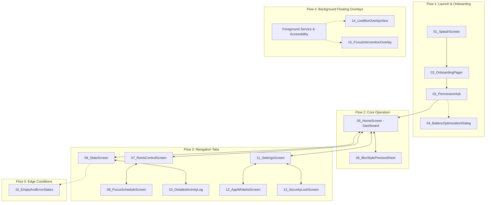

# SafeScreen — স্ক্রিন ডিজাইন ওয়ার্কফ্লো ও চেকলিস্ট (Screen Workflow)

> 📌 **গুরুত্বপূর্ণ নোট:**  
> এই ফোল্ডারে অ্যাপের প্রতিটি স্ক্রিনের ভিজ্যুয়াল ডিজাইন ইমেজ ক্রমানুসারে সংরক্ষণ করা হবে।  
> ব্যবহারকারী ChatGPT ব্যবহার করে প্রম্পটের মাধ্যমে ইমেজগুলো জেনারেট করে সংশ্লিষ্ট ফোল্ডারে সেভ করবেন।  
> কোনো এআই এজেন্ট বা ডেভেলপার নিজে থেকে ইমেজগুলো তৈরি হয়েছে বলে ধরে নেবে না; ইমেজ সংরক্ষণ শেষ হলে কোডিং পর্যায়ে এগুলোকে মূল ভিজ্যুয়াল রেফারেন্স হিসেবে ব্যবহার করা হবে।

---

## ১. প্রজেক্টের স্ক্রিন ডিরেক্টরি স্ট্রাকচার

```
Screen Workflow/
├── README.md                           # এই ফাইল (ওয়ার্কফ্লো ও স্ট্যাটাস ট্র্যাকার)
├── MASTER_UI_PROMPTS.md                # ChatGPT প্রম্পট ও Kotlin ইমপ্লিমেন্টেশন প্রম্পট বুক
│
├── 01_Onboarding/                      # অনবোর্ডিং ও স্প্ল্যাশ স্ক্রিনের ইমেজ
│   ├── 01_SplashScreen.png
│   └── 02_OnboardingPager.png
│
├── 02_Permissions/                     # পারমিশন হাব ও ডায়ালগসমূহের ইমেজ
│   ├── 03_PermissionHub.png
│   └── 04_BatteryOptimizationDialog.png
│
├── 03_Home_Dashboard/                  # মূল হোম ড্যাশবোর্ড ও ব্লার কাস্টমাইজেশন
│   ├── 05_HomeScreen.png
│   └── 06_BlurStylePreviewSheet.png
│
├── 04_Reels_And_Focus/                 # রিলস/শর্টস কন্ট্রোল ও ফোকাস শিডিউলার
│   ├── 07_ReelsControlScreen.png
│   └── 08_FocusScheduleScreen.png
│
├── 05_Stats_And_Analytics/             # অফলাইন চার্ট, পরিসংখ্যান ও টাইমলাইন
│   ├── 09_StatsScreen.png
│   └── 10_DetailedActivityLog.png
│
├── 06_Settings_And_Security/           # সেটিংস, হোয়াইটলিস্ট ও পিন/বায়োমেট্রিক
│   ├── 11_SettingsScreen.png
│   ├── 12_AppWhitelistScreen.png
│   └── 13_SecurityLockScreen.png
│
├── 07_Overlays_And_Dialogs/            # রিয়েল-টাইম ব্লার ও ফোকাস ব্লকার ওভারলে
│   ├── 14_LiveBlurOverlayView.png
│   └── 15_FocusInterventionOverlay.png
│
└── 08_Error_And_Empty_States/          # ফাঁকা অবস্থা ও সিস্টেম ত্রুটির ফলব্যাক
    └── 16_EmptyAndErrorStates.png
```

---

## ২. স্ক্রিন নেভিগেশন ম্যাপ ও ওয়ার্কফ্লো



---

## ৩. স্ক্রিন ডিজাইন ও ইমেজ জেনারেশন চেকলিস্ট

| ক্রম | স্ক্রিনের নাম | টার্গেট ফোল্ডার ও ফাইল | ইমেজ স্ট্যাটাস | Kotlin ইমপ্লিমেন্টেশন স্ট্যাটাস |
| :---: | :--- | :--- | :---: | :---: |
| 01 | Splash Screen | `01_Onboarding/01_SplashScreen.png` | ⏳ Pending User | ⏳ Pending Design |
| 02 | Onboarding Pager | `01_Onboarding/02_OnboardingPager.png` | ⏳ Pending User | ⏳ Pending Design |
| 03 | Permission Hub | `02_Permissions/03_PermissionHub.png` | ⏳ Pending User | ⏳ Pending Design |
| 04 | Battery Optimization Dialog | `02_Permissions/04_BatteryOptimizationDialog.png` | ⏳ Pending User | ⏳ Pending Design |
| 05 | Home Dashboard | `03_Home_Dashboard/05_HomeScreen.png` | ⏳ Pending User | ⏳ Pending Design |
| 06 | Blur Style Preview Sheet | `03_Home_Dashboard/06_BlurStylePreviewSheet.png` | ⏳ Pending User | ⏳ Pending Design |
| 07 | Reels & Shorts Control | `04_Reels_And_Focus/07_ReelsControlScreen.png` | ⏳ Pending User | ⏳ Pending Design |
| 08 | Focus Schedule Screen | `04_Reels_And_Focus/08_FocusScheduleScreen.png` | ⏳ Pending User | ⏳ Pending Design |
| 09 | Protection Stats Screen | `05_Stats_And_Analytics/09_StatsScreen.png` | ⏳ Pending User | ⏳ Pending Design |
| 10 | Detailed Activity Log | `05_Stats_And_Analytics/10_DetailedActivityLog.png` | ⏳ Pending User | ⏳ Pending Design |
| 11 | Main Settings Screen | `06_Settings_And_Security/11_SettingsScreen.png` | ⏳ Pending User | ⏳ Pending Design |
| 12 | App Whitelist Screen | `06_Settings_And_Security/12_AppWhitelistScreen.png` | ⏳ Pending User | ⏳ Pending Design |
| 13 | Security Lock (PIN/Biometric) | `06_Settings_And_Security/13_SecurityLockScreen.png` | ⏳ Pending User | ⏳ Pending Design |
| 14 | Live Blur Overlay View | `07_Overlays_And_Dialogs/14_LiveBlurOverlayView.png` | ⏳ Pending User | ⏳ Pending Design |
| 15 | Focus Intervention Overlay | `07_Overlays_And_Dialogs/15_FocusInterventionOverlay.png` | ⏳ Pending User | ⏳ Pending Design |
| 16 | Empty & Error States | `08_Error_And_Empty_States/16_EmptyAndErrorStates.png` | ⏳ Pending User | ⏳ Pending Design |

---

## ৪. পরবর্তী ধাপের কাজের নির্দেশনা (How to Proceed)

1. [**`MASTER_UI_PROMPTS.md`**](./MASTER_UI_PROMPTS.md) ফাইলটি খুলুন।
2. প্রথম অংশে দেওয়া **Master Context Prompt** কপি করে ChatGPT-তে পাঠান।
3. এরপর মডিউল ১ থেকে শুরু করে প্রতি মডিউলের **প্রম্পট A** কপি করে ChatGPT-তে দিন এবং তৈরি হওয়া ইমেজগুলো ডাউনলোড করে উপরের সংশ্লিষ্ট ফোল্ডারে সেভ করুন।
4. সবগুলো ইমেজ ফোল্ডারে সেভ হয়ে গেলে চেকলিস্টটি আপডেট করুন এবং আমরা **প্রম্পট B** ব্যবহার করে Kotlin + Jetpack Compose-এ পিক্সেল-পারফেক্ট ইমপ্লিমেন্টেশন শুরু করব।

