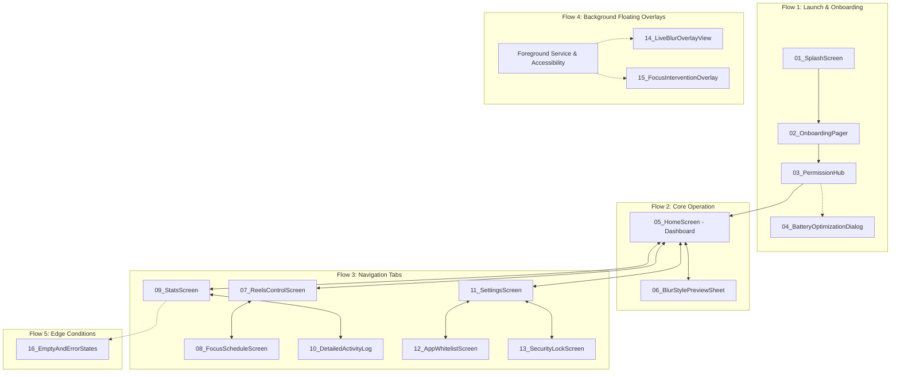

# SafeScreen — স্ক্রিন ডিজাইন ওয়ার্কফ্লো ও চেকলিস্ট (Screen Workflow)

> 📌 **গুরুত্বপূর্ণ নোট:**  
> এই ফোল্ডারে অ্যাপের প্রতিটি স্ক্রিনের ভিজ্যুয়াল ডিজাইন ইমেজ ক্রমানুসারে সংরক্ষণ করা হয়েছে।  
> ব্যবহারকারী ChatGPT ব্যবহার করে প্রম্পটের মাধ্যমে ইমেজগুলো জেনারেট করে সংশ্লিষ্ট ফোল্ডারে সেভ করেছেন এবং সমস্ত ইমেজ ভেরিফাই করা হয়েছে।  
> পরবর্তীতে কোডিং পর্যায়ে (Phase 2B) এগুলোকে মূল ভিজ্যুয়াল রেফারেন্স হিসেবে ব্যবহার করে Kotlin + Jetpack Compose-এ পিক্সেল-পারফেক্ট ইউআই কোড লেখা হবে।

---

## ১. প্রজেক্টের স্ক্রিন ডিরেক্টরি স্ট্রাকচার

```
Screen Workflow/
├── README.md                           # এই ফাইল (ওয়ার্কফ্লো ও স্ট্যাটাস ট্র্যাকার)
├── MASTER_UI_PROMPTS.md                # সমৃদ্ধ মাস্টার প্রম্পট বুক ও কোডিং এজেন্ট গাইড
│
├── 01_Onboarding/                      # অনবোর্ডিং ও স্প্ল্যাশ স্ক্রিনের ইমেজ
│   └── SafeScreen Cybersecurity Onboard Due.png
│
├── 02_Permissions/                     # পারমিশন হাব ও ব্যাটারি ডায়ালগ ইমেজ
│   └── SafeScreen Permission Flow Mocku.png
│
├── 03_Home_Dashboard/                  # মূল ড্যাশবোর্ড ও ব্লার কাস্টমাইজেশন শিট
│   └── SafeScreen Neon Shield Dashboard.png
│
├── 04_Reels_And_Focus/                 # রিলস কন্ট্রোল ও ফোকাস শিডিউলার ইমেজ
│   ├── Neon SafeScreen Focus Dashboard.png
│   └── photo_6284782712203710858_w.jpg
│
├── 05_Stats_And_Analytics/             # অফলাইন চার্ট, পরিসংখ্যান ও টাইমলাইন লগ
│   └── SafeScreen Neon Protection Dashb.png
│
├── 06_Settings_And_Security/           # সেটিংস, হোয়াইটলিস্ট ও পিন/বায়োমেট্রিক প্যাড
│   └── SafeScreen Neon Security UI Mock.png
│
├── 07_Overlays_And_Dialogs/            # রিয়েল-টাইম ব্লার ও ফোকাস ব্লকার ওভারলে
│   ├── Neon Focus Time Alert Overlay.png
│   └── SafeScreen Protection and Focus .png
│
└── 08_Error_And_Empty_States/          # ফাঁকা অবস্থা ও সিস্টেম ত্রুটির ফলব্যাক
    ├── SafeScreen Activity Log_ All Cle.png
    └── SafeScreen Neon Status Dashboard.png
```

---

## ২. স্ক্রিন নেভিগেশন ম্যাপ ও ওয়ার্কফ্লো



---

## ৩. স্ক্রিন ডিজাইন ও ইমেজ জেনারেশন চেকলিস্ট

| ক্রম | স্ক্রিনের নাম | টার্গেট ফোল্ডার ও সংরক্ষিত ফাইল | ইমেজ স্ট্যাটাস | Kotlin ইমপ্লিমেন্টেশন স্ট্যাটাস |
| :---: | :--- | :--- | :---: | :---: |
| 01 | Splash Screen | `01_Onboarding/SafeScreen Cybersecurity Onboard Due.png` | ✅ Saved & Verified | ⏳ Ready for Coding (Phase 2B) |
| 02 | Onboarding Pager | `01_Onboarding/SafeScreen Cybersecurity Onboard Due.png` | ✅ Saved & Verified | ⏳ Ready for Coding (Phase 2B) |
| 03 | Permission Hub | `02_Permissions/SafeScreen Permission Flow Mocku.png` | ✅ Saved & Verified | ⏳ Ready for Coding (Phase 2B) |
| 04 | Battery Optimization Dialog | `02_Permissions/SafeScreen Permission Flow Mocku.png` | ✅ Saved & Verified | ⏳ Ready for Coding (Phase 2B) |
| 05 | Home Dashboard | `03_Home_Dashboard/SafeScreen Neon Shield Dashboard.png` | ✅ Saved & Verified | ⏳ Ready for Coding (Phase 2B) |
| 06 | Blur Style Preview Sheet | `03_Home_Dashboard/SafeScreen Neon Shield Dashboard.png` | ✅ Saved & Verified | ⏳ Ready for Coding (Phase 2B) |
| 07 | Reels & Shorts Control | `04_Reels_And_Focus/Neon SafeScreen Focus Dashboard.png` | ✅ Saved & Verified | ⏳ Ready for Coding (Phase 2B) |
| 08 | Focus Schedule Screen | `04_Reels_And_Focus/Neon SafeScreen Focus Dashboard.png` | ✅ Saved & Verified | ⏳ Ready for Coding (Phase 2B) |
| 09 | Protection Stats Screen | `05_Stats_And_Analytics/SafeScreen Neon Protection Dashb.png` | ✅ Saved & Verified | ⏳ Ready for Coding (Phase 2B) |
| 10 | Detailed Activity Log | `05_Stats_And_Analytics/SafeScreen Neon Protection Dashb.png` | ✅ Saved & Verified | ⏳ Ready for Coding (Phase 2B) |
| 11 | Main Settings Screen | `06_Settings_And_Security/SafeScreen Neon Security UI Mock.png` | ✅ Saved & Verified | ⏳ Ready for Coding (Phase 2B) |
| 12 | App Whitelist Screen | `06_Settings_And_Security/SafeScreen Neon Security UI Mock.png` | ✅ Saved & Verified | ⏳ Ready for Coding (Phase 2B) |
| 13 | Security Lock (PIN/Biometric) | `06_Settings_And_Security/SafeScreen Neon Security UI Mock.png` | ✅ Saved & Verified | ⏳ Ready for Coding (Phase 2B) |
| 14 | Live Blur Overlay View | `07_Overlays_And_Dialogs/SafeScreen Protection and Focus .png` | ✅ Saved & Verified | ⏳ Ready for Coding (Phase 2B) |
| 15 | Focus Intervention Overlay | `07_Overlays_And_Dialogs/Neon Focus Time Alert Overlay.png` | ✅ Saved & Verified | ⏳ Ready for Coding (Phase 2B) |
| 16 | Empty & Error States | `08_Error_And_Empty_States/SafeScreen Neon Status Dashboard.png` | ✅ Saved & Verified | ⏳ Ready for Coding (Phase 2B) |

---

## ৪. পরবর্তী ধাপের কাজের নির্দেশনা (How to Proceed)

1. [**`MASTER_UI_PROMPTS.md`**](./MASTER_UI_PROMPTS.md) ফাইলটি খুলুন।
2. প্রতিটি স্ক্রিনের সমৃদ্ধ **প্রম্পট B** এবং সংশ্লিষ্ট সেভ করা রেফারেন্স ইমেজ অনুসরণ করুন।
3. `presentation/screens/` এর ভেতরে প্রতিটি স্ক্রিনের কম্পোজ কোড লিখুন এবং `UiState` ও `UiEvent` কন্ট্রাক্ট বজায় রাখুন।
4. প্রতিটি স্ক্রিনের জন্য লাইট ও ডার্ক মোডে `@Preview` নিশ্চিত করুন।
